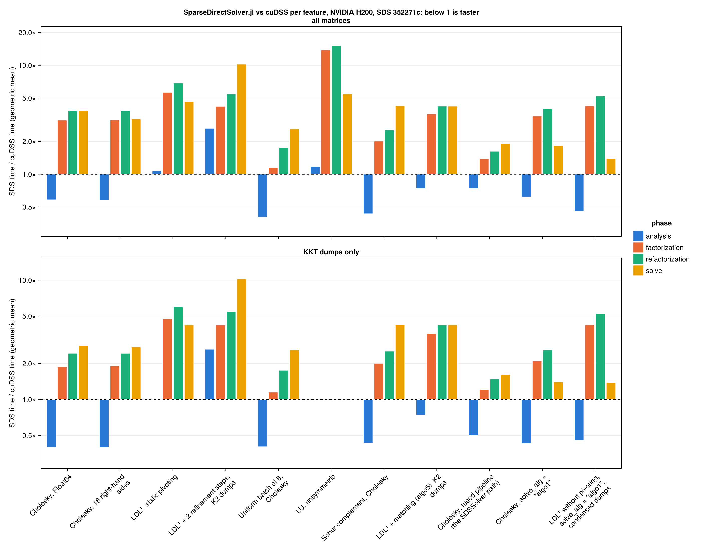

# SparseDirectSolver.jl

[](https://exanauts.github.io/SparseDirectSolver.jl/dev/)
[](https://github.com/exanauts/SparseDirectSolver.jl/actions/workflows/ci.yml)

> **This package is vibe-coded.** The background research (`RESEARCH.md`), the
> design (`PLAN.md`), the task breakdown (`TASKS.md`), the implementation, the
> tests, the benchmarks and this documentation were written by coding agents
> (Claude) in agent-driven sessions. The owner wrote the prompts and the review
> notes, reviewed and merged the pull requests and ran the benchmarks, but did
> not write the code by hand. Treat the text as a description of what the agents
> built, and the test suite, the ported CUDSS.jl tests and the cuDSS comparison
> as the evidence. Validate the numerics on your own matrices before relying on
> them.

A portable sparse direct solver for GPUs, written in Julia on
[KernelAbstractions.jl](https://github.com/JuliaGPU/KernelAbstractions.jl). It
factors symmetric positive definite (LLᵀ/LLᴴ), symmetric indefinite (LDLᵀ/LDLᴴ
with 1×1 and 2×2 pivots) and general (LDU) sparse matrices and solves with them
on the device. It keeps the parameter names and phases of
[CUDSS.jl](https://github.com/exanauts/CUDSS.jl), the Julia interface of NVIDIA
cuDSS, so that [MadNLP](https://github.com/MadNLP/MadNLP.jl) and other cuDSS
users can switch mechanically, and it is not tied to one vendor.

## Status

Version 0.3.0, the first release registered in the Julia General registry.
Julia 1.13 or later. Every backend below runs the same multifrontal kernels;
only the dense operations on the large fronts go through a vendor library.
It is young: complete enough for the MadNLP workload and checked against CPU
reference factorizations and the ported CUDSS.jl tests, but slower than cuDSS
on most matrices and with features still missing; the
[What to expect](https://exanauts.github.io/SparseDirectSolver.jl/dev/man/expectations/)
page of the documentation says what the release covers, how far it is from
cuDSS and what is not there. The changes are in [`CHANGELOG.md`](CHANGELOG.md).

| Backend | Loaded by | Dense layer on large fronts | Tested |
| --- | --- | --- | --- |
| CUDA | `using CUDA` (CUDA.jl ≥ 6.5) | cuBLAS, cuSOLVER | CI, self-hosted runner |
| AMDGPU (ROCm) | `using AMDGPU` (≥ 2.10) | rocBLAS, rocSOLVER | CI, self-hosted runner |
| oneAPI | `using oneAPI` (≥ 2.10) | oneMKL level-3 BLAS; LAPACK steps on the KernelAbstractions kernels | CI on Aurora (Intel Data Center GPU Max 1550) |
| Metal | `using Metal` (≥ 1.11) | MPS Cholesky for fronts at least 64 wide; `Float32` only | by hand on an M4 Max, no CI |
| CPU | nothing (KernelAbstractions `CPU()`) | KernelAbstractions kernels | CI |

Element types `Float32`, `Float64`, `ComplexF32`, `ComplexF64` (Metal:
`Float32`); index types `Int32` and `Int64`. Unsupported structures, phases
and parameters raise `NotSupportedError`; there is no silent fallback.

## What it does

* **Analysis on the host.** AMD or nested dissection (METIS; `nd_nseps`,
  `nd_seed`) chosen per matrix by a cost model that scores the depth of the
  supernodal schedule next to the flops, elimination tree, supernodes with
  GPU-tuned amalgamation, a static factor layout and the assembly maps built
  on the device. For symmetric indefinite matrices the analysis pairs
  structurally zero pivots with a partner (`pivot_pairs`) so that the in-front
  pivoting can form the 2×2 blocks KKT systems need.
* **Three numeric regimes.** Fused subtree-per-workgroup kernels for the many
  small fronts at the bottom of the tree, fused level-batched per-front
  kernels for medium fronts, and dense `potrf`/`trsm`/`syrk` through a
  backend-agnostic dense interface for large fronts (vendor library where one
  exists, allocation-free KernelAbstractions kernels otherwise). No
  allocation and no host synchronization after the analysis, so a
  refactorization plus solve can be captured and replayed.
* **Cholesky** (`"SPD"`, `"HPD"`), **LDLᵀ/LDLᴴ** (`"S"`, `"H"`) with in-front
  Bunch–Kaufman pivoting, `pivot_threshold`, static perturbation
  (`pivot_epsilon`, `pivot_epsilon_alg`) with a user-chosen sign per row
  (`pivot_sign`, which cuDSS cannot do), `inertia`, `npivots` and
  `pivot_stats` read back from the device, and **LU** (`"G"`) with threshold
  partial pivoting inside the fully-summed block of each front, `perm_row`,
  `perm_col` and solves with `A`, `Aᵀ` and `Aᴴ`. The device pivot sequences
  equal those of the CPU reference factorizations, which serve as oracles.
* **Solves** with multiple right-hand sides, the forward, diagonal and
  backward sub-phases, `solve_mode` (transposed and conjugated systems),
  iterative refinement (`ir_n_steps`, `ir_tol`) or FGMRES-IR with the
  factorization as preconditioner (`ir_mode = "fgmres"`, after `using
  Krylov`), and `user_host_interrupt` polled between launch groups.
  `solve_alg = "algo1"` (set before the analysis; real `"SPD"`, no-pivot
  `"S"`/`"H"`, one right-hand side, CUDA/AMDGPU/oneAPI) solves with the
  partitioned-inverse sweeps of the fused pipeline after the stock
  factorization; the default stays the level-batched sweeps.
* **Uniform batches** for every structure (`ubatch_size`, `ubatch_index`,
  `ubatch_mask`; values as a long vector, a matrix or a 3-D array; per-member
  `info` and statistics). **Schur complement mode** (`schur_mode`,
  `user_schur_indices`, `schur_shape`, `schur_matrix` dense or CSR, the
  `solve_*_schur` phases). **Matching and scaling** (`matching_alg`
  `"algo1"`–`"algo6"`, MC64 jobs on the host; `perm_matching`, `scale_row`,
  `scale_col`), with 2×2 pivot pairs from the matching for the symmetric
  structures.
* **The API.** `DirectSolver`, `execute!` with the cuDSS phase strings, the
  named wrappers `analyze!`, `factorize!`, `refactorize!`, `solve!`,
  `SparseDirectSolver.update!` (public, not exported), `setparam!`/`getparam`,
  and the `LinearAlgebra` layer (`cholesky`, `ldlt`, `lu` and their `!`
  forms, `ldiv!`, `\`, `logabsdet`, `logdet`, `diag`, `nnz`), checked by the
  test suite of CUDSS.jl ported to this package. `SDS_LOG_LEVEL=1` logs a
  summary per phase.
* **`FusedSolver`**, the fused pipeline: one dependency-counter factorization
  kernel per refactorization (or a few, split at the wide fronts) and a
  partitioned-inverse solve, behind the same verbs as `DirectSolver`, on
  every GPU backend. Real `"SPD"` and no-pivot `"S"` matrices, one right-hand
  side; the factorization is bitwise reproducible, `deterministic_mode = 1`
  makes the solve so too. Tuned per architecture through `SDSTuning`,
  including optional CUDA-graph replay of the refactorization and the solve
  (`graph_max_n`). This is the path the MadNLP extension runs.
* **MadNLP** (`using MadNLP`): the linear solver `SDSSolver` with the options
  `sds_factorization` (`:cholesky`, `:ldl`), `sds_pivoting` (`:none` on the
  fused pipeline, `:bk` on the stock in-front Bunch–Kaufman path, which is
  also the CPU-backend path), `sds_pivot_threshold`, `sds_reordering`,
  `sds_user_perm` and `sds_tuning`.

**Not there yet.** The fused factorization on `DirectSolver` itself, and
CUDA-graph capture of the stock refactorization and solve (tasks T37–T38 of
`TASKS.md`; the fused solve is on `DirectSolver` as `solve_alg = "algo1"`
since T36, the fused factorization is reached through `FusedSolver`); `schedule = "syncfree"`; non-uniform batches;
ND partition-tree export and the ordering cache; mixed precision
(`factor_precision`); hybrid host memory; delayed pivots; `ComplexF32` on
Metal. The options `max_lu_nnz`, `host_nthreads` and
`use_cuda_register_memory` are accepted and warn once if set.

## Performance against cuDSS

Time of SparseDirectSolver.jl divided by the time of cuDSS 1.0.0 (CUDSS.jl
1.0) per feature and phase, geometric mean over the benchmark matrices (below
1 is faster), on an NVIDIA H200 allocated exclusively through Slurm (commit
352271c, 2026-11-09). Every row is a feature through the handle API;
`cholesky_fused` is the fused pipeline the MadNLP extension runs,
`cholesky_algo1` and `ldlt_algo1` the `solve_alg = "algo1"` solve on
`DirectSolver`. The cuDSS matching is off except in `ldlt_matching` (cuDSS 1.0
turns it on by default for `S`/`G`), as on the SDS side. The lower panel
keeps the MadNLP KKT dumps only.



The gap depends on the matrix class. On the condensed KKT systems the fused
pipeline refactorizes at 1.48× and solves at 1.62× the cuDSS time
(geometric mean over 10 dumps), on the SuiteSparse/Laplacian set at 1.94× and
2.67×; the stock handle-API Cholesky reads 2.44× (KKT) and
9.52× (SuiteSparse/Laplacian) for the refactorization. On the 78k-bus
condensed ACOPF KKT system (n = 674 562) the fused pipeline refactorizes in
16.6 ms against 10.4 ms for cuDSS and solves in 2.34 ms against
1.63 ms; `solve_alg = "algo1"` brings the `DirectSolver` solve there from
10.3 ms to 2.33 ms. Per-matrix numbers are in
[`bench/comparison/comparison.md`](bench/comparison/comparison.md), regenerated
by hand with `bench/compare.jl` and `bench/compare_report.jl` (see
[`bench/README.md`](bench/README.md)); the MadNLP end-to-end record across
seven GPUs is in [`bench/PERFORMANCE-2026-10.md`](bench/PERFORMANCE-2026-10.md),
the tuning methodology in [`bench/ARCH-TUNING.md`](bench/ARCH-TUNING.md) and
the gap analysis in [`PERFORMANCE.md`](PERFORMANCE.md).

## Installation

```julia
using Pkg
Pkg.add("SparseDirectSolver")
```

Until the registration pull request in General is merged, install from the
repository:

```julia
Pkg.add(url = "https://github.com/exanauts/SparseDirectSolver.jl")
```

The backend extensions load with the backend package (table above). CUDA.jl's
split packages CUDACore, cuBLAS, cuSOLVER and cuSPARSE trigger the CUDA
extension; `using CUDA` loads them all. CUDA.jl 6.5 exports an `update!` of
its own, so this package does not export its `update!`: write
`SparseDirectSolver.update!` or `using SparseDirectSolver: update!`.
`using Krylov` enables FGMRES refinement, `using MadNLP` the `SDSSolver`
linear solver.

## Usage

The handle API mirrors CUDSS.jl: a `DirectSolver` is created from a CSR matrix
on a KernelAbstractions backend, with a structure string (`"SPD"`, `"HPD"`,
`"S"`, `"H"`, or `"G"` for LU) and the triangle that is read (`'L'`, `'U'` or
`'F'`; ignored for `"G"`, which reads the full matrix, as in cuDSS). Phases run
with `execute!`.

```julia
using SparseDirectSolver, SparseArrays, LinearAlgebra
using CUDA, CUDA.CUSPARSE
using SparseDirectSolver: update!                     # not exported (CUDA.jl 6.5 exports one too)

n = 1000
A = sprand(n, n, 0.005); A = A * A' + I               # SPD on the host
A_gpu = CuSparseMatrixCSR(tril(A))                    # lower triangle on the device
b_gpu = CuVector(rand(n)); x_gpu = similar(b_gpu)

solver = DirectSolver(A_gpu, "SPD", 'L')
setparam!(solver, "reordering_alg", "default")        # cuDSS parameter names
execute!("analysis", solver, x_gpu, b_gpu)            # reordering + symbolic factorization
execute!("factorization", solver, x_gpu, b_gpu)
execute!("solve", solver, x_gpu, b_gpu)
getparam(solver, "info") == 0 || error("factorization failed")

# new values, same pattern: reuse the analysis
update!(solver, CuSparseMatrixCSR(tril(A + I)))
execute!("refactorization", solver, x_gpu, b_gpu)
execute!("solve", solver, x_gpu, b_gpu)
```

Symmetric indefinite systems (a KKT matrix, say) use `"S"` or `"H"`; the
pivoting parameters keep their cuDSS names and `pivot_sign` is the addition:

```julia
K_gpu = CuSparseMatrixCSR(tril(K))                    # [H Jᵀ; J -δI], nh primal and nj dual rows
solver = DirectSolver(K_gpu, "S", 'L')
setparam!(solver, "pivot_threshold", 0.01)            # Bunch–Kaufman acceptance (default)
setparam!(solver, "pivot_sign", Int8[fill(1, nh); fill(-1, nj)])   # sign of a perturbed pivot
setparam!(solver, "ir_n_steps", 2)                    # refinement steps inside "solve"
execute!("analysis", solver, x_gpu, b_gpu)
execute!("factorization", solver, x_gpu, b_gpu)
getparam(solver, "inertia")                           # (npos, nneg), as MadNLP reads it
getparam(solver, "pivot_stats")                       # (npos, nneg, nzero, nperturbed, n2x2)
execute!("solve", solver, x_gpu, b_gpu)
```

Two things to know for KKT systems. The 2×2 pivot pairs that let the in-front
pivoting handle zero dual diagonals (`pivot_pairs`, default `"default"`, also
`"all"` and `"none"`) are chosen from the values present when `"analysis"`
runs, so run the analysis after the first KKT assembly, not on an empty
buffer. Badly scaled systems (late IPM iterates) need the MC64 scaling,
`setparam!(solver, "matching_alg", "algo5")`, which brings the K2 systems of
MadNLP to a handful of perturbed pivots at about 2× the factor size, plus a
few refinement steps; `ir_mode = "fgmres"` (after `using Krylov`) is the
robust choice there.

General matrices use `"G"` and the same phases; `getparam(solver, "perm_row")`
and `"perm_col"` give the composed permutations.

The same code runs on the CPU backend by wrapping the host CSR arrays in a
`CSR` (or passing a `SparseMatrixCSC`) instead of a `CuSparseMatrixCSR`. The
`LinearAlgebra` layer offers the usual shortcuts, with two refinement steps per
solve by default; on the host it takes `CSR(A)`, since `cholesky` of a
`SparseMatrixCSC` belongs to CHOLMOD:

```julia
F = cholesky(A_gpu; view = 'L')        # analysis + factorization
ldiv!(x_gpu, F, b_gpu)                 # or x_gpu = F \ b_gpu
cholesky!(F, A_gpu_new)                # refactorization with the same pattern
F = ldlt(K_gpu; view = 'L')            # LDLᵀ (real) or LDLᴴ (complex)
F = lu(G_gpu)                          # LDU with in-front pivoting
logabsdet(F)
```

The fused pipeline has the same verbs. Its values alias the caller's buffer,
so the interior-point loop is "write new values, refactorize, solve":

```julia
F = FusedSolver(A_gpu, "SPD", 'L')     # or "S" for a no-pivot LDLᵀ; GPU backends only
analyze!(F)                            # ordering, symbolic analysis, the fused plans
factorize!(F)
x_gpu = F \ b_gpu                      # partitioned-inverse solve
A_gpu.nzVal .*= 2                      # new values in the same buffer
refactorize!(F)
solve!(F, x_gpu, b_gpu)
```

With MadNLP, on a GPU:

```julia
using MadNLP, MadNLPGPU, CUDA, SparseDirectSolver
result = madnlp(model; linear_solver = SDSSolver,
                kkt_system = MadNLP.SparseCondensedKKTSystem)
```

## Running the tests

```bash
julia --project=. -e 'using Pkg; Pkg.test()'                       # CPU backend + GPUs found in test/Project.toml
SDS_TEST_GPU=0 julia --project=. -e 'using Pkg; Pkg.test()'        # CPU only
SDS_TEST_CPU=0 julia --project=. -e 'using Pkg; Pkg.test()'        # GPU only
SDS_TEST_ONLY="test_symbolic_etree,test_options" julia --project=. -e 'using Pkg; Pkg.test()'
SDS_TEST_SKIP="test_aqua" julia --project=. -e 'using Pkg; Pkg.test()'
SDS_TEST_ELTYPES="Float64,ComplexF32" julia --project=. -e 'using Pkg; Pkg.test()'  # element types (default all four)
PTR_NUM_JOBS=4 julia --project=. -e 'using Pkg; Pkg.test()'                 # number of test workers
```

The test files run in parallel worker processes (ParallelTestRunner.jl); the
long files run once per element type. Most of the wall time is kernel
compilation, not tests. GPU backends are tested when their package is present
in the test environment and functional. CI adds them itself; locally, add one
with `julia --project=test -e 'using Pkg; Pkg.add("CUDA")'` and do not commit
that change to `test/Project.toml`.

## Development

The project is developed task by task. `TASKS.md` lists the tasks, each with
the tests that must pass and the report of every finished one; the next task
is the one whose GitHub issue the owner opened. Each task lands through a pull
request that CI and an automated review (`claude-review.yml`) must pass, and
the owner merges by hand. CI runs the CPU suite on the self-hosted `kkt`
machine, the GPU suite on the self-hosted `cuda` and `amdgpu` runners and on
Aurora through ALCF GitLab CI for oneAPI, and Aqua on GitHub; Metal has no CI
leg. Between tasks the owner updates `STATE.md` and `PLAN.md`. `AGENTS.md`
describes the workflow and the code conventions. Prototypes removed from
`bench/` are kept at the tag `prototypes-2026-10`.

Project documents:

* [Documentation](https://exanauts.github.io/SparseDirectSolver.jl/dev/) — user guide and API reference.
* [`CHANGELOG.md`](CHANGELOG.md) — changes per release.
* [`PLAN.md`](PLAN.md) — design, API, milestones.
* [`TASKS.md`](TASKS.md) — implementation tasks and their reports.
* [`STATE.md`](STATE.md) — the current state: what exists, the numbers, the open tasks and issues.
* [`PERFORMANCE.md`](PERFORMANCE.md) — gap analysis against cuDSS and the experiment plan.
* [`RESEARCH.md`](RESEARCH.md) — background and state of the art.
* [`bench/README.md`](bench/README.md) — benchmark harness and cuDSS baselines.

## License

MIT, see [`LICENSE`](LICENSE).
