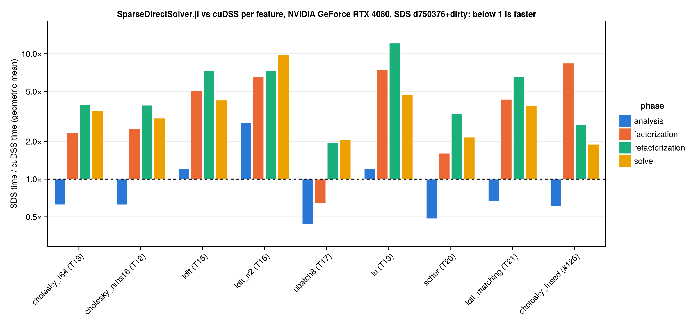

# SparseDirectSolver.jl

[](https://exanauts.github.io/SparseDirectSolver.jl/dev/)
[](https://github.com/exanauts/SparseDirectSolver.jl/actions/workflows/ci.yml)

> **This package is vibe-coded.** The background research (`RESEARCH.md`), the
> design (`PLAN.md`), the task breakdown (`TASKS.md`), the implementation, the
> tests, the benchmarks and this documentation were written by coding agents
> (Claude) in agent-driven sessions. The owner wrote the prompts and the review
> notes, reviewed and merged the pull requests and ran the benchmarks, but did
> not write the code by hand. Treat the text as a description of what the agents
> built, and the test suite, the ported CUDSS.jl tests and the cuDSS comparison
> as the evidence. Validate the numerics on your own matrices before relying on
> them.

A portable sparse direct solver (LLᵀ/LLᴴ, LDLᵀ/LDLᴴ, LDU) for GPUs, written in
Julia on KernelAbstractions.jl. It keeps the parameter names
and phases of [CUDSS.jl](https://github.com/exanauts/CUDSS.jl) so that MadNLP
and other cuDSS users can switch to it mechanically, and targets CUDA, AMDGPU,
oneAPI, Metal and the KernelAbstractions CPU backend.

**Status: v0.2, not registered, under construction.** Working today on the
CPU backend, CUDA, AMDGPU (ROCm), Metal (`Float32`, tested on an M4 Max) and
oneAPI (tested on an Intel Data Center GPU Max 1550):

* host symbolic analysis: AMD or nested dissection (METIS; `nd_nseps` and
  `nd_seed` are parameters) ordering, chosen per matrix by a cost model that
  scores the depth of the supernodal schedule next to the flops, elimination
  tree, supernodes with GPU-tuned amalgamation, static factor layout and
  assembly maps built on the device; for symmetric
  indefinite matrices the analysis pairs structurally zero pivots with a
  partner (`pivot_pairs`, MA57-style compressed-graph ordering) so that the
  in-front pivoting can form the 2×2 blocks that KKT systems need;
* GPU multifrontal Cholesky (`"SPD"`, `"HPD"`) in three regimes: fused
  subtree-per-workgroup kernels for the many small fronts at the bottom of the
  tree, fused level-batched per-front kernels for medium fronts, and dense
  `potrf`/`trsm`/`syrk` through a backend-agnostic dense interface for large
  fronts: cuBLAS and cuSOLVER on CUDA, rocBLAS and rocSOLVER on AMDGPU, oneMKL
  level-3 BLAS on oneAPI (the LAPACK steps on the KernelAbstractions
  fallbacks), MPS GEMM/SYRK and MPS Cholesky for fronts at least 64 wide on
  Metal, KernelAbstractions fallbacks otherwise;
* GPU LDLᵀ/LDLᴴ (`"S"`, `"H"`) with in-front Bunch–Kaufman 1×1/2×2 pivoting,
  `pivot_threshold`, static perturbation (`pivot_epsilon`, `pivot_epsilon_alg`)
  with a user-chosen sign per row (`pivot_sign`, which cuDSS cannot do), and
  `inertia`, `npivots` and `pivot_stats` read back from the device; the same
  pivot sequence as the CPU reference LDLᵀ, which serves as its oracle;
* GPU LU (`"G"`, `L D U` on the symmetric pattern of `A + Aᵀ`) with row
  interchanges inside the fully-summed block of each front (threshold partial
  pivoting, `pivot_threshold`), static perturbation of tiny pivots, `perm_row`
  and `perm_col`, and solves with `A`, `Aᵀ` and `Aᴴ`; the same pivot sequence
  as the CPU reference LU;
* uniform batches for every structure (`ubatch_size`, `ubatch_index`,
  `ubatch_mask`; values as a long vector, a matrix or a 3-D array; strided
  and 3-D right-hand sides; per-member `info` and statistics), with
  strided-batched vendor calls on the root fronts;
* GPU triangular solves with multiple right-hand sides, forward, diagonal and
  backward sub-phases, permutations, `solve_mode` (transposed and conjugated
  systems), and iterative refinement (`ir_n_steps`, `ir_tol`), allocation-free
  after the analysis, or FGMRES-IR with the factorization as preconditioner
  (`ir_mode = "fgmres"`, after `using Krylov`); `user_host_interrupt` is
  polled between launch groups;
* Schur complement mode (`schur_mode`, `user_schur_indices`) for every
  structure: the Schur rows and columns are ordered last and their front is
  assembled but not factored; `schur_shape` (exact symbolic pattern) and
  `schur_matrix` (dense, or CSR of one triangle or the full matrix), and the
  `solve_fwd_schur`/`solve_diag`/`solve_bwd_schur` phases of cuDSS;
* matching and scaling (`matching_alg` `"algo1"`–`"algo6"`, MC64 jobs 1–5 on
  the host): `"G"` factors the row/column-scaled matrix with the matched
  entries on the diagonal, the symmetric structures a symmetrically scaled
  matrix (inertia preserved) with 2×2 pivot pairs from the matching;
  `perm_matching`, `scale_row`, `scale_col`;
* the public API: `DirectSolver`, `execute!` with cuDSS phase strings, named
  phase wrappers, `update!`, `setparam!`/`getparam`, and the `LinearAlgebra`
  layer (`cholesky`, `cholesky!`, `ldlt`, `ldlt!`, `lu`, `lu!`, `ldiv!`, `\`,
  `logabsdet`, `logdet`, `diag`, `nnz`),
  checked by the test suite of CUDSS.jl ported to this package; phase logging
  through `SDS_LOG_LEVEL`;
* `FusedSolver`: the fused pipeline of `src/fused.jl` (one dependency-counter
  factorization kernel, a partitioned-inverse solve) behind the same verbs as
  `DirectSolver`, on every GPU backend (the CPU backend is refused), for real
  `"SPD"` and no-pivot `"S"` matrices and one right-hand side (everything else
  raises `NotSupportedError`);
* a MadNLP linear solver (`using MadNLP` enables the extension): `SDSSolver`,
  used as `madnlp(model; linear_solver = SDSSolver, kkt_system =
  MadNLP.SparseCondensedKKTSystem)`, with the options `sds_factorization`
  (`:cholesky`, or `:ldl` without pivoting, the inertia read from the signs of
  `D`), `sds_pivoting = :bk` for the in-front Bunch–Kaufman path (with
  `sds_pivot_threshold`), `sds_reordering`, `sds_user_perm` and `sds_tuning`,
  a bundle of performance
  knobs with measured per-architecture defaults (oneAPI and Metal get the AMD
  profile). It runs the fused pipeline of `src/fused.jl`, one
  dependency-counter kernel per refactorization and a partitioned-inverse
  solve, on every GPU backend; the benchmark row `cholesky_fused` below
  measures that path.

Not there yet: the fused pipeline under the `execute!` of `DirectSolver`
(`solve_alg = "algo1"`, tasks T24–T26, after which it is the Cholesky and LDLᵀ
path of every `DirectSolver`; `FusedSolver` has its own `execute!` today), the
sm_89 performance work of T34, non-uniform batches, ND partition-tree export, mixed
precision, hybrid host memory, delayed pivots, allocation-free
KernelAbstractions dense fallbacks on oneAPI and Metal (T32), and `ComplexF32`
on Metal. Unsupported structures, phases and parameters raise
`NotSupportedError` rather than falling back silently. The remaining gap to
cuDSS is performance, not features (see below and
[`PERFORMANCE.md`](PERFORMANCE.md)); a MadNLP end-to-end run on CUDA and AMD
lives in [`bench/e2e/`](bench/e2e/).

* [Documentation](https://exanauts.github.io/SparseDirectSolver.jl/dev/) — user guide and API reference.
* [`PLAN.md`](PLAN.md) — design, API, milestones.
* [`TASKS.md`](TASKS.md) — implementation tasks and their reports.
* [`STATE.md`](STATE.md) — the owner's state review between tasks.
* [`PERFORMANCE.md`](PERFORMANCE.md) — gap analysis against cuDSS and the experiment plan.
* [`RESEARCH.md`](RESEARCH.md) — background and state of the art.
* [`bench/README.md`](bench/README.md) — benchmark harness and cuDSS baselines.
* [`bench/comparison/comparison.md`](bench/comparison/comparison.md) — per-feature performance comparison with cuDSS.
* [`bench/PERFORMANCE-2026-10.md`](bench/PERFORMANCE-2026-10.md) — the MadNLP extension on the 78k-bus ACOPF KKT across seven GPUs; [`bench/ARCH-TUNING.md`](bench/ARCH-TUNING.md) — how its per-architecture defaults were measured.

## Performance against cuDSS

Time of SparseDirectSolver.jl divided by the time of cuDSS per feature and
phase, geometric mean over the benchmark matrices (below 1 is faster), measured
on an RTX 4080. Every row is a feature the package implements, through the
handle API; `cholesky_fused` is the fused pipeline that the MadNLP extension
runs, until T24–T26 make it the path of `DirectSolver`'s `execute!`. The
comparison was measured at commit d750376 (2026-10-28), before T33 moved the
construction of the fused plans into the analysis; the `cholesky_fused`
factorization column there still includes building the plans.
Per-matrix numbers are in
[`bench/comparison/comparison.md`](bench/comparison/comparison.md); the plot
is regenerated by hand with `bench/compare.jl` and `bench/compare_report.jl`
(see [`bench/README.md`](bench/README.md)). The end-to-end MadNLP run on the
78k-bus ACOPF system needs about 17 GB of device memory, more than the
RTX 4080 has; its per-GPU record is
[`bench/PERFORMANCE-2026-10.md`](bench/PERFORMANCE-2026-10.md).



## Installation

The package is not registered yet. Julia 1.13 or later is required.

```julia
using Pkg
Pkg.add(url = "https://github.com/exanauts/SparseDirectSolver.jl")
```

The CUDA extension is triggered by CUDA.jl's packages CUDACore, cuBLAS,
cuSOLVER and cuSPARSE, which `using CUDA` loads (`CuSparseMatrixCSR`/`CuSparseMatrixCSC`
constructors, cuBLAS/cuSOLVER dense kernels; CUDA.jl 6.5 exports an `update!`
of its own, so import this package's explicitly with
`using SparseDirectSolver: update!` when both are loaded); loading AMDGPU.jl
enables the AMDGPU extension (`ROCSparseMatrixCSR`/`ROCSparseMatrixCSC`
constructors, rocBLAS/rocSOLVER dense kernels; ROCm must be found by AMDGPU.jl);
loading oneAPI.jl enables the oneAPI extension
(`oneSparseMatrixCSR`/`oneSparseMatrixCSC` constructors, oneMKL BLAS kernels);
loading Metal.jl enables the Metal extension (`CSR` of `MtlArray`s, `Float32`,
MPS Cholesky for wide fronts); loading Krylov.jl enables FGMRES refinement;
loading MadNLP.jl enables the `SDSSolver` linear solver.

## Usage

The handle API mirrors CUDSS.jl: a `DirectSolver` is created from a CSR matrix
living on a KernelAbstractions backend, with a structure string (`"SPD"`,
`"HPD"`, `"S"`, `"H"`, or `"G"` for LU) and the triangle that is read (`'L'`,
`'U'` or `'F'`; ignored for `"G"`, which reads the full matrix, as in cuDSS).
Phases are run with `execute!`.

```julia
using SparseDirectSolver, SparseArrays, LinearAlgebra
using CUDA, CUDA.CUSPARSE
using SparseDirectSolver: update!                     # CUDA.jl 6.5 exports an update! too

n = 1000
A = sprand(n, n, 0.005); A = A * A' + I               # SPD on the host
A_gpu = CuSparseMatrixCSR(tril(A))                    # lower triangle on the device
b_gpu = CuVector(rand(n)); x_gpu = similar(b_gpu)

solver = DirectSolver(A_gpu, "SPD", 'L')
setparam!(solver, "reordering_alg", "default")        # cuDSS parameter names
execute!("analysis", solver, x_gpu, b_gpu)            # reordering + symbolic factorization
execute!("factorization", solver, x_gpu, b_gpu)
execute!("solve", solver, x_gpu, b_gpu)
getparam(solver, "info") == 0 || error("factorization failed")

# new values, same pattern: reuse the analysis
update!(solver, CuSparseMatrixCSR(tril(A + I)))
execute!("refactorization", solver, x_gpu, b_gpu)
execute!("solve", solver, x_gpu, b_gpu)
```

Symmetric indefinite systems (a KKT matrix, say) use `"S"` or `"H"`; the
pivoting parameters keep their cuDSS names and `pivot_sign` is the addition:

```julia
K_gpu = CuSparseMatrixCSR(tril(K))                    # [H Jᵀ; J -δI], nh primal and nj dual rows
solver = DirectSolver(K_gpu, "S", 'L')
setparam!(solver, "pivot_threshold", 0.01)            # Bunch–Kaufman acceptance (default)
setparam!(solver, "pivot_sign", Int8[fill(1, nh); fill(-1, nj)])   # sign of a perturbed pivot
setparam!(solver, "ir_n_steps", 2)                    # refinement steps inside "solve"
execute!("analysis", solver, x_gpu, b_gpu)
execute!("factorization", solver, x_gpu, b_gpu)
getparam(solver, "inertia")                           # (npos, nneg), as MadNLP reads it
getparam(solver, "pivot_stats")                       # (npos, nneg, nzero, nperturbed, n2x2)
execute!("solve", solver, x_gpu, b_gpu)
```

Two things to know for KKT systems. The 2×2 pivot pairs that let the in-front
pivoting handle zero dual diagonals (`pivot_pairs`, default `"default"`, also
`"all"` and `"none"`) are chosen from the values present when `"analysis"`
runs, so run the analysis after the first KKT assembly, not on an empty
buffer. Badly scaled systems (late IPM iterates) need the MC64 scaling,
`setparam!(solver, "matching_alg", "algo5")`, which brings the K2 systems of
MadNLP to a handful of perturbed pivots at about 2× the factor size, plus a
few refinement steps; `ir_mode = "fgmres"` (after `using Krylov`) is the
robust choice there.

General matrices use `"G"` and the same phases; `getparam(solver, "perm_row")`
and `"perm_col"` give the composed permutations.

The same `DirectSolver` code runs on the CPU backend by wrapping the host CSR
arrays in a `CSR` (or passing a `SparseMatrixCSC`) instead of a
`CuSparseMatrixCSR`. The `LinearAlgebra` layer offers the usual shortcuts, with
two refinement steps per solve by default; on the host it takes `CSR(A)`, since
`cholesky` of a `SparseMatrixCSC` belongs to CHOLMOD:

```julia
F = cholesky(A_gpu; view = 'L')        # analysis + factorization
ldiv!(x_gpu, F, b_gpu)                 # or x_gpu = F \ b_gpu
cholesky!(F, A_gpu_new)                # refactorization with the same pattern
F = ldlt(K_gpu; view = 'L')            # LDLᵀ (real) or LDLᴴ (complex)
F = lu(G_gpu)                          # LDU with in-front pivoting
logabsdet(F)
```

The named phase wrappers `analyze!`, `factorize!`, `refactorize!` and `solve!`
are equivalent to the corresponding `execute!` calls. `SDS_LOG_LEVEL=1` prints
a summary per phase, `2` adds the residual of every refinement step.

## Running the tests

```bash
julia --project=. -e 'using Pkg; Pkg.test()'                       # CPU backend + GPUs found in test/Project.toml
SDS_TEST_GPU=0 julia --project=. -e 'using Pkg; Pkg.test()'        # CPU only
SDS_TEST_CPU=0 julia --project=. -e 'using Pkg; Pkg.test()'        # GPU only
SDS_TEST_ONLY="test_symbolic_etree,test_options" julia --project=. -e 'using Pkg; Pkg.test()'
SDS_TEST_SKIP="test_aqua" julia --project=. -e 'using Pkg; Pkg.test()'
SDS_TEST_ELTYPES="Float64,ComplexF32" julia --project=. -e 'using Pkg; Pkg.test()'  # element types (default all four)
PTR_NUM_JOBS=4 julia --project=. -e 'using Pkg; Pkg.test()'                 # number of test workers
```

The test files run in parallel worker processes (ParallelTestRunner.jl); the
long files run once per element type. Most of the wall time is kernel
compilation, not tests. GPU backends are tested when their package is present
in the test environment and functional. CI adds them itself; locally, add one
with `julia --project=test -e 'using Pkg; Pkg.add("CUDA")'` and do not commit
that change to `test/Project.toml`.

## Development

The project is developed task by task; `TASKS.md` lists the tasks and the
report of every finished one. Each task lands through a pull request that CI
(the CPU suite on the self-hosted `kkt` machine, the GPU suite on the
self-hosted `cuda` and `amdgpu` runners and on Aurora through ALCF GitLab CI
for oneAPI, Aqua on GitHub; Metal has no CI leg) and an automated review must
pass; between tasks the owner reviews the state (`STATE.md`) and refreshes
`PLAN.md`. Besides the task PRs, out-of-chain housekeeping PRs clean up
documentation, tests and the repository between tasks; the prototypes they
removed are kept at the tag `prototypes-2026-10`. `AGENTS.md` describes the
workflow and the code conventions.

## License

MIT, see [`LICENSE`](LICENSE).
