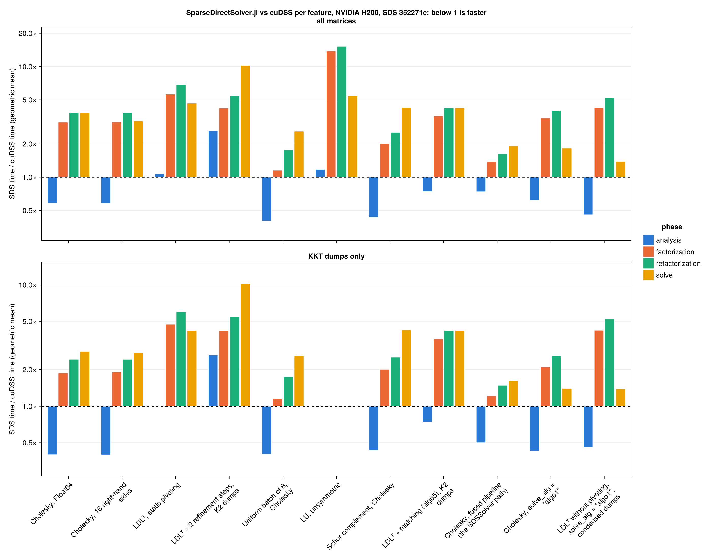

# cuDSS vs SparseDirectSolver.jl

Generated by `bench/compare_report.jl` from `bench/comparison/{cudss,sds}.csv` (`bench/compare.jl`). Times are BenchmarkTools medians per phase on a fresh solver; the ratio is SDS time / cuDSS time, so below 1 means SparseDirectSolver.jl is faster.

## Overview

Geometric mean of the SDS/cuDSS ratio over the matrices both solvers ran.

| feature | task | status | matrices | analysis | factorization | refactorization | solve |
| --- | --- | --- | --- | --- | --- | --- | --- |
| Cholesky, Float64 | T13 | done | 15 | 0.58× | 3.13× | 3.84× | 3.84× |
| Cholesky, 16 right-hand sides | T12 | done | 15 | 0.58× | 3.16× | 3.83× | 3.20× |
| LDLᵀ, static pivoting | T15 | done | 24 | 1.07× | 5.64× | 6.87× | 4.66× |
| LDLᵀ + 2 refinement steps, K2 dumps | T16 | done | 9 | 2.64× | 4.20× | 5.46× | 10.24× |
| Uniform batch of 8, Cholesky | T17 | done | 10 | 0.40× | 1.15× | 1.76× | 2.60× |
| LU, unsymmetric | T19 | done | 2 | 1.17× | 13.82× | 15.19× | 5.46× |
| Schur complement, Cholesky | T20 | done | 10 | 0.43× | 2.01× | 2.54× | 4.25× |
| LDLᵀ + matching (algo5), K2 dumps | T21 | done | 9 | 0.74× | 3.57× | 4.21× | 4.21× |
| Cholesky, fused pipeline (the `SDSSolver` path) | #126 | done | 15 | 0.74× | 1.38× | 1.62× | 1.92× |
| Cholesky, `solve_alg = "algo1"` | T36 | done | 15 | 0.62× | 3.41× | 4.01× | 1.83× |
| LDLᵀ without pivoting, `solve_alg = "algo1"`, condensed dumps | T36 | done | 10 | 0.46× | 4.23× | 5.24× | 1.39× |

## Overview, KKT dumps only

The same over the MadNLP KKT dumps (matrices `kkt_*`) only, the interior-point workload; features without KKT dumps stay blank.

| feature | task | status | matrices | analysis | factorization | refactorization | solve |
| --- | --- | --- | --- | --- | --- | --- | --- |
| Cholesky, Float64 | T13 | done | 10 | 0.40× | 1.88× | 2.44× | 2.83× |
| Cholesky, 16 right-hand sides | T12 | done | 10 | 0.40× | 1.92× | 2.44× | 2.75× |
| LDLᵀ, static pivoting | T15 | done | 19 | 1.01× | 4.73× | 6.00× | 4.20× |
| LDLᵀ + 2 refinement steps, K2 dumps | T16 | done | 9 | 2.64× | 4.20× | 5.46× | 10.24× |
| Uniform batch of 8, Cholesky | T17 | done | 10 | 0.40× | 1.15× | 1.76× | 2.60× |
| LU, unsymmetric | T19 | done |  |  |  |  |  |
| Schur complement, Cholesky | T20 | done | 10 | 0.43× | 2.01× | 2.54× | 4.25× |
| LDLᵀ + matching (algo5), K2 dumps | T21 | done | 9 | 0.74× | 3.57× | 4.21× | 4.21× |
| Cholesky, fused pipeline (the `SDSSolver` path) | #126 | done | 10 | 0.50× | 1.21× | 1.48× | 1.62× |
| Cholesky, `solve_alg = "algo1"` | T36 | done | 10 | 0.43× | 2.10× | 2.60× | 1.41× |
| LDLᵀ without pivoting, `solve_alg = "algo1"`, condensed dumps | T36 | done | 10 | 0.46× | 4.23× | 5.24× | 1.39× |

## Cholesky, Float64

`cholesky_f64`, T13 (done), structure `SPD`, Float64, nrhs = 1; cuDSS: `matching_alg = "none"`.

| matrix | n | analysis cuDSS ms | SDS ms | ratio | factorization cuDSS ms | SDS ms | ratio | refactorization cuDSS ms | SDS ms | ratio | solve cuDSS ms | SDS ms | ratio | nnz(L) cuDSS | SDS | relres cuDSS | SDS |
| --- | --- | --- | --- | --- | --- | --- | --- | --- | --- | --- | --- | --- | --- | --- | --- | --- | --- |
| Boeing/bcsstk38 | 8032 | 38.8 | 44.9 | 1.16× | 1.93 | 16.6 | 8.59× | 1.72 | 16.6 | 9.66× | 0.57 | 2.22 | 3.89× | 7.99e+05 | 8.05e+05 | 1.08e-10 | 8.74e-11 |
| GHS_psdef/apache2 | 715176 | 4.56e+03 | 6.4e+03 | 1.40× | 76.8 | 512 | 6.66× | 76.5 | 512 | 6.69× | 3.38 | 70.7 | 20.91× | 1.45e+08 | 1.29e+08 | 1.79e-10 | 1.58e-10 |
| HB/bcsstk17 | 10974 | 46.5 | 56.7 | 1.22× | 1.96 | 17.2 | 8.78× | 1.76 | 17.2 | 9.75× | 0.586 | 2.69 | 4.60× | 1.08e+06 | 1.12e+06 | 3.93e-11 | 5.23e-11 |
| kkt_pglib_opf_case118_ieee_condensed_1 | 1088 | 14.5 | 5.6 | 0.39× | 0.988 | 0.939 | 0.95× | 0.594 | 0.925 | 1.56× | 0.174 | 0.64 | 3.67× | 1.52e+04 | 1.33e+04 | 8.34e-05 | 0.000181 |
| kkt_pglib_opf_case118_ieee_condensed_10 | 1088 | 14.5 | 5.62 | 0.39× | 0.77 | 0.942 | 1.22× | 0.566 | 0.922 | 1.63× | 0.161 | 0.654 | 4.07× | 1.52e+04 | 1.33e+04 | 1.28e-05 | 8.57e-06 |
| kkt_pglib_opf_case118_ieee_condensed_20 | 1088 | 14.5 | 5.6 | 0.39× | 0.77 | 0.938 | 1.22× | 0.54 | 0.922 | 1.71× | 0.155 | 0.708 | 4.58× | 1.52e+04 | 1.33e+04 | 0.143 | 0.109 |
| kkt_pglib_opf_case1354_pegase_condensed_1 | 11192 | 62.1 | 56.5 | 0.91× | 0.81 | 2.81 | 3.46× | 0.629 | 2.79 | 4.43× | 0.546 | 1.24 | 2.27× | 1.55e+05 | 1.41e+05 | 0.000598 | 0.000567 |
| kkt_pglib_opf_case1354_pegase_condensed_10 | 11192 | 62.1 | 56.5 | 0.91× | 0.766 | 2.8 | 3.65× | 0.636 | 2.79 | 4.39× | 0.567 | 1.27 | 2.24× | 1.55e+05 | 1.41e+05 | 0.000129 | 0.000105 |
| kkt_pglib_opf_case1354_pegase_condensed_20 | 11192 | 62.1 | 56.7 | 0.91× | 0.764 | 2.8 | 3.66× | 0.631 | 2.79 | 4.43× | 0.568 | 1.24 | 2.19× | 1.55e+05 | 1.41e+05 | 7.65e-05 | 5.41e-05 |
| kkt_pglib_opf_case14_ieee_condensed_1 | 118 | 8.86 | 1.08 | 0.12× | 0.173 | 0.183 | 1.06× | 0.12 | 0.169 | 1.41× | 0.0814 | 0.154 | 1.89× | 1.27e+03 | 1.12e+03 | 3.3e-06 | 3.79e-06 |
| kkt_pglib_opf_case14_ieee_condensed_10 | 118 | 8.87 | 1.08 | 0.12× | 0.164 | 0.179 | 1.09× | 0.121 | 0.166 | 1.38× | 0.0817 | 0.155 | 1.90× | 1.27e+03 | 1.12e+03 | 0.000293 | 0.000388 |
| kkt_pglib_opf_case14_ieee_condensed_16 | 118 | 8.88 | 1.06 | 0.12× | 0.164 | 0.18 | 1.10× | 0.112 | 0.167 | 1.49× | 0.0803 | 0.155 | 1.93× | 1.27e+03 | 1.12e+03 | 7.49e-05 | 4.39e-05 |
| kkt_pglib_opf_case78484_epigrids_condensed_10 | 674562 | 3.81e+03 | 4.97e+03 | 1.30× | 10.8 | 71.9 | 6.63× | 10.4 | 71.9 | 6.91× | 1.65 | 10.3 | 6.23× | 1.56e+07 | 1.48e+07 | 0.0179 | 0.0152 |
| lap2d_300 | 90000 | 298 | 373 | 1.26× | 3.31 | 21 | 6.33× | 2.73 | 21 | 7.69× | 0.763 | 4.14 | 5.43× | 2.43e+06 | 2.47e+06 | 1.78e-12 | 1.82e-12 |
| lap3d_40 | 64000 | 375 | 442 | 1.18× | 13.6 | 212 | 15.61× | 13.2 | 212 | 16.10× | 1.38 | 12.1 | 8.77× | 1.75e+07 | 1.44e+07 | 8.19e-14 | 7.5e-14 |

## Cholesky, 16 right-hand sides

`cholesky_nrhs16`, T12 (done), structure `SPD`, Float64, nrhs = 16; cuDSS: `matching_alg = "none"`.

| matrix | n | analysis cuDSS ms | SDS ms | ratio | factorization cuDSS ms | SDS ms | ratio | refactorization cuDSS ms | SDS ms | ratio | solve cuDSS ms | SDS ms | ratio | nnz(L) cuDSS | SDS | relres cuDSS | SDS |
| --- | --- | --- | --- | --- | --- | --- | --- | --- | --- | --- | --- | --- | --- | --- | --- | --- | --- |
| Boeing/bcsstk38 | 8032 | 38.8 | 44.4 | 1.14× | 1.93 | 16.6 | 8.59× | 1.75 | 16.6 | 9.50× | 0.764 | 2.29 | 2.99× | 7.99e+05 | 8.05e+05 | 1.32e-10 | 2.04e-10 |
| GHS_psdef/apache2 | 715176 | 4.56e+03 | 5.93e+03 | 1.30× | 76.9 | 512 | 6.66× | 76.6 | 512 | 6.68× | 13.7 | 102 | 7.43× | 1.45e+08 | 1.29e+08 | 1.83e-10 | 1.56e-10 |
| HB/bcsstk17 | 10974 | 46.6 | 56.8 | 1.22× | 1.98 | 17.2 | 8.67× | 1.77 | 17.2 | 9.72× | 0.821 | 2.85 | 3.48× | 1.08e+06 | 1.12e+06 | 4.52e-11 | 6.04e-11 |
| kkt_pglib_opf_case118_ieee_condensed_1 | 1088 | 14.5 | 5.56 | 0.38× | 0.919 | 0.941 | 1.02× | 0.588 | 0.922 | 1.57× | 0.201 | 0.671 | 3.33× | 1.52e+04 | 1.33e+04 | 0.000111 | 0.000223 |
| kkt_pglib_opf_case118_ieee_condensed_10 | 1088 | 14.5 | 5.59 | 0.39× | 0.768 | 0.934 | 1.22× | 0.567 | 0.922 | 1.63× | 0.196 | 0.67 | 3.41× | 1.52e+04 | 1.33e+04 | 1.7e-05 | 1.02e-05 |
| kkt_pglib_opf_case118_ieee_condensed_20 | 1088 | 14.5 | 5.57 | 0.38× | 0.782 | 0.936 | 1.20× | 0.533 | 0.952 | 1.78× | 0.202 | 0.699 | 3.45× | 1.52e+04 | 1.33e+04 | 0.387 | 0.304 |
| kkt_pglib_opf_case1354_pegase_condensed_1 | 11192 | 62.2 | 56.3 | 0.91× | 0.834 | 2.81 | 3.37× | 0.63 | 2.8 | 4.45× | 0.589 | 1.44 | 2.44× | 1.55e+05 | 1.41e+05 | 0.000706 | 0.000528 |
| kkt_pglib_opf_case1354_pegase_condensed_10 | 11192 | 62.1 | 56.6 | 0.91× | 0.782 | 2.81 | 3.60× | 0.624 | 2.79 | 4.47× | 0.577 | 1.44 | 2.49× | 1.55e+05 | 1.41e+05 | 0.000148 | 0.000117 |
| kkt_pglib_opf_case1354_pegase_condensed_20 | 11192 | 62.2 | 56.6 | 0.91× | 0.783 | 2.82 | 3.60× | 0.633 | 2.79 | 4.41× | 0.465 | 1.45 | 3.12× | 1.55e+05 | 1.41e+05 | 9.37e-05 | 7.34e-05 |
| kkt_pglib_opf_case14_ieee_condensed_1 | 118 | 8.88 | 1.07 | 0.12× | 0.165 | 0.183 | 1.11× | 0.128 | 0.168 | 1.31× | 0.0965 | 0.169 | 1.75× | 1.27e+03 | 1.12e+03 | 2.72e-06 | 3.93e-06 |
| kkt_pglib_opf_case14_ieee_condensed_10 | 118 | 8.86 | 1.08 | 0.12× | 0.158 | 0.182 | 1.15× | 0.114 | 0.168 | 1.47× | 0.0883 | 0.172 | 1.94× | 1.27e+03 | 1.12e+03 | 0.00135 | 0.000839 |
| kkt_pglib_opf_case14_ieee_condensed_16 | 118 | 8.89 | 1.09 | 0.12× | 0.151 | 0.182 | 1.21× | 0.12 | 0.169 | 1.41× | 0.0906 | 0.169 | 1.86× | 1.27e+03 | 1.12e+03 | 6.91e-05 | 8.09e-05 |
| kkt_pglib_opf_case78484_epigrids_condensed_10 | 674562 | 3.81e+03 | 4.92e+03 | 1.29× | 10.8 | 71.9 | 6.66× | 10.5 | 71.8 | 6.87× | 5.29 | 28.1 | 5.32× | 1.56e+07 | 1.48e+07 | 0.018 | 0.0154 |
| lap2d_300 | 90000 | 298 | 372 | 1.25× | 3.48 | 21 | 6.03× | 2.77 | 21 | 7.60× | 1.46 | 6.26 | 4.28× | 2.43e+06 | 2.47e+06 | 1.8e-12 | 1.82e-12 |
| lap3d_40 | 64000 | 374 | 446 | 1.19× | 13.7 | 212 | 15.43× | 13.2 | 212 | 16.08× | 3.09 | 14.4 | 4.66× | 1.75e+07 | 1.44e+07 | 8.91e-14 | 6.69e-14 |

## LDLᵀ, static pivoting

`ldlt`, T15 (done), structure `S`, Float64, nrhs = 1; cuDSS: `matching_alg = "none"`.

| matrix | n | analysis cuDSS ms | SDS ms | ratio | factorization cuDSS ms | SDS ms | ratio | refactorization cuDSS ms | SDS ms | ratio | solve cuDSS ms | SDS ms | ratio | nnz(L) cuDSS | SDS | relres cuDSS | SDS |
| --- | --- | --- | --- | --- | --- | --- | --- | --- | --- | --- | --- | --- | --- | --- | --- | --- | --- |
| Boeing/bcsstk38 | 8032 | 38.8 | 55.3 | 1.42× | 2.94 | 33.8 | 11.50× | 2.77 | 33.7 | 12.20× | 0.744 | 2.51 | 3.37× | 7.99e+05 | 8.05e+05 | 7.88e-11 | 1.73e-10 |
| GHS_psdef/apache2 | 715176 | 4.55e+03 | 6.42e+03 | 1.41× | 121 | 1.28e+03 | 10.56× | 120 | 1.28e+03 | 10.61× | 3.53 | 78.2 | 22.17× | 1.45e+08 | 1.29e+08 | 1.57e-10 | 1.42e-10 |
| HB/bcsstk17 | 10974 | 46.5 | 67.3 | 1.45× | 3 | 33.4 | 11.16× | 2.8 | 33.4 | 11.93× | 0.766 | 3.02 | 3.94× | 1.08e+06 | 1.12e+06 | 3.59e-11 | 3.92e-11 |
| kkt_pglib_opf_case118_ieee_condensed_1 | 1088 | 14.5 | 5.89 | 0.41× | 0.802 | 2.23 | 2.78× | 0.586 | 2.22 | 3.79× | 0.182 | 0.669 | 3.67× | 1.52e+04 | 1.33e+04 | 6.79e-05 | 6.44e-05 |
| kkt_pglib_opf_case118_ieee_condensed_10 | 1088 | 14.5 | 5.87 | 0.40× | 0.746 | 2.18 | 2.92× | 0.543 | 2.2 | 4.05× | 0.181 | 0.671 | 3.70× | 1.52e+04 | 1.33e+04 | 1.37e-05 | 8.12e-06 |
| kkt_pglib_opf_case118_ieee_condensed_20 | 1088 | 14.5 | 5.9 | 0.41× | 0.742 | 2.22 | 2.98× | 0.532 | 2.24 | 4.20× | 0.183 | 0.672 | 3.67× | 1.52e+04 | 1.33e+04 | 0.179 | 0.131 |
| kkt_pglib_opf_case118_ieee_k2_1 | 3150 | 19.4 | 69.5 | 3.59× | 0.763 | 2.03 | 2.66× | 0.558 | 2.02 | 3.62× | 0.18 | 0.881 | 4.90× | 2.02e+04 | 2.1e+04 | 1.2 | 0.174 |
| kkt_pglib_opf_case118_ieee_k2_10 | 3150 | 19.4 | 70.3 | 3.62× | 0.942 | 1.97 | 2.09× | 0.577 | 1.97 | 3.41× | 0.185 | 0.884 | 4.77× | 2.02e+04 | 2.05e+04 | 8.16 | 0.00467 |
| kkt_pglib_opf_case118_ieee_k2_20 | 3150 | 19.6 | 68.5 | 3.50× | 0.722 | 1.94 | 2.69× | 0.588 | 1.93 | 3.27× | 0.195 | 0.891 | 4.58× | 2.02e+04 | 2.05e+04 | 14.8 | 0.0448 |
| kkt_pglib_opf_case1354_pegase_condensed_1 | 11192 | 62.1 | 59.6 | 0.96× | 0.939 | 8.97 | 9.55× | 0.777 | 8.96 | 11.54× | 0.255 | 1.36 | 5.33× | 1.55e+05 | 1.41e+05 | 0.000832 | 0.000467 |
| kkt_pglib_opf_case1354_pegase_condensed_10 | 11192 | 62.1 | 59.5 | 0.96× | 0.929 | 9.03 | 9.72× | 0.76 | 9.02 | 11.87× | 0.275 | 1.36 | 4.97× | 1.55e+05 | 1.41e+05 | 0.00016 | 0.000101 |
| kkt_pglib_opf_case1354_pegase_condensed_20 | 11192 | 62.1 | 59.9 | 0.96× | 0.946 | 9.1 | 9.62× | 0.757 | 9.09 | 12.02× | 0.258 | 1.37 | 5.31× | 1.55e+05 | 1.41e+05 | 7.44e-05 | 5.46e-05 |
| kkt_pglib_opf_case1354_pegase_k2_1 | 33811 | 113 | 1.17e+03 | 10.42× | 1.2 | 7.22 | 6.03× | 0.997 | 7.19 | 7.21× | 0.3 | 1.8 | 6.01× | 2.02e+05 | 2.16e+05 | 101 | 18 |
| kkt_pglib_opf_case1354_pegase_k2_10 | 33811 | 113 | 1.24e+03 | 11.01× | 1.2 | 6.57 | 5.47× | 0.937 | 6.57 | 7.02× | 0.314 | 1.64 | 5.21× | 2.02e+05 | 2.2e+05 | 51.7 | 58.6 |
| kkt_pglib_opf_case1354_pegase_k2_20 | 33811 | 113 | 1.24e+03 | 10.96× | 1.18 | 6.99 | 5.92× | 0.977 | 6.97 | 7.13× | 0.316 | 1.72 | 5.44× | 2.02e+05 | 2.21e+05 | 80.4 | 13.8 |
| kkt_pglib_opf_case14_ieee_condensed_1 | 118 | 8.89 | 1.14 | 0.13× | 0.173 | 0.548 | 3.17× | 0.133 | 0.528 | 3.97× | 0.108 | 0.177 | 1.64× | 1.27e+03 | 1.12e+03 | 1.09e-06 | 8.07e-07 |
| kkt_pglib_opf_case14_ieee_condensed_10 | 118 | 8.89 | 1.16 | 0.13× | 0.177 | 0.565 | 3.19× | 0.125 | 0.527 | 4.22× | 0.107 | 0.175 | 1.64× | 1.27e+03 | 1.12e+03 | 0.000278 | 0.000159 |
| kkt_pglib_opf_case14_ieee_condensed_16 | 118 | 8.87 | 1.16 | 0.13× | 0.17 | 0.594 | 3.49× | 0.132 | 0.54 | 4.08× | 0.107 | 0.173 | 1.62× | 1.27e+03 | 1.12e+03 | 7.61e-05 | 2.58e-05 |
| kkt_pglib_opf_case14_ieee_k2_1 | 344 | 9.65 | 5.19 | 0.54× | 0.193 | 0.869 | 4.50× | 0.15 | 0.854 | 5.68× | 0.119 | 0.689 | 5.81× | 2.02e+03 | 2.14e+03 | 0.189 | 1.4e-08 |
| kkt_pglib_opf_case14_ieee_k2_10 | 344 | 9.65 | 6.08 | 0.63× | 0.185 | 0.86 | 4.64× | 0.149 | 0.848 | 5.69× | 0.123 | 0.685 | 5.55× | 2.02e+03 | 2.15e+03 | 0.341 | 2.71e-05 |
| kkt_pglib_opf_case14_ieee_k2_15 | 344 | 9.7 | 3.1 | 0.32× | 0.188 | 1.21 | 6.45× | 0.149 | 1.17 | 7.88× | 0.12 | 0.684 | 5.70× | 2.02e+03 | 3.27e+03 | 0.276 | 0.482 |
| kkt_pglib_opf_case78484_epigrids_condensed_10 | 674562 | 3.82e+03 | 5.47e+03 | 1.43× | 16.2 | 355 | 21.90× | 15.8 | 354 | 22.44× | 1.73 | 11.9 | 6.89× | 1.56e+07 | 1.48e+07 | 0.0174 | 0.0123 |
| lap2d_300 | 90000 | 283 | 382 | 1.35× | 4.43 | 33.9 | 7.66× | 4.16 | 33.9 | 8.14× | 0.879 | 5 | 5.69× | 2.43e+06 | 2.47e+06 | 1.59e-12 | 1.58e-12 |
| lap3d_40 | 64000 | 363 | 450 | 1.24× | 22.5 | 359 | 15.99× | 22.4 | 359 | 16.06× | 1.48 | 14.1 | 9.49× | 1.75e+07 | 1.44e+07 | 7.5e-14 | 6.27e-14 |

## LDLᵀ + 2 refinement steps, K2 dumps

`ldlt_ir2`, T16 (done), structure `S`, Float64, nrhs = 1; both solvers: `ir_n_steps = 2`; cuDSS: `matching_alg = "none"`.

| matrix | n | analysis cuDSS ms | SDS ms | ratio | factorization cuDSS ms | SDS ms | ratio | refactorization cuDSS ms | SDS ms | ratio | solve cuDSS ms | SDS ms | ratio | nnz(L) cuDSS | SDS | relres cuDSS | SDS |
| --- | --- | --- | --- | --- | --- | --- | --- | --- | --- | --- | --- | --- | --- | --- | --- | --- | --- |
| kkt_pglib_opf_case118_ieee_k2_1 | 3150 | 19.4 | 70 | 3.61× | 0.952 | 2.03 | 2.13× | 0.584 | 2.03 | 3.47× | 0.464 | 3.87 | 8.34× | 2.02e+04 | 2.1e+04 | 0.00223 | 3.48e-09 |
| kkt_pglib_opf_case118_ieee_k2_10 | 3150 | 19.4 | 70.1 | 3.61× | 0.755 | 1.99 | 2.63× | 0.524 | 1.98 | 3.78× | 0.46 | 3.73 | 8.12× | 2.02e+04 | 2.05e+04 | 0.856 | 1.04e-10 |
| kkt_pglib_opf_case118_ieee_k2_20 | 3150 | 19.6 | 69 | 3.53× | 0.751 | 1.97 | 2.62× | 0.538 | 1.98 | 3.68× | 0.441 | 3.75 | 8.51× | 2.02e+04 | 2.05e+04 | 0.045 | 3.74e-08 |
| kkt_pglib_opf_case1354_pegase_k2_1 | 33811 | 113 | 1.17e+03 | 10.35× | 1.16 | 7.19 | 6.22× | 0.971 | 7.19 | 7.41× | 0.838 | 23.2 | 27.68× | 2.02e+05 | 2.16e+05 | 36.2 | 0.0281 |
| kkt_pglib_opf_case1354_pegase_k2_10 | 33811 | 113 | 1.23e+03 | 10.91× | 1.16 | 6.56 | 5.67× | 0.994 | 6.6 | 6.64× | 0.834 | 22.7 | 27.22× | 2.02e+05 | 2.2e+05 | 2.02 | 1.49 |
| kkt_pglib_opf_case1354_pegase_k2_20 | 33811 | 113 | 1.26e+03 | 11.14× | 1.2 | 7 | 5.82× | 0.977 | 6.98 | 7.15× | 0.834 | 23 | 27.54× | 2.02e+05 | 2.21e+05 | 0.967 | 0.0281 |
| kkt_pglib_opf_case14_ieee_k2_1 | 344 | 9.66 | 5.15 | 0.53× | 0.185 | 0.866 | 4.69× | 0.148 | 0.856 | 5.79× | 0.295 | 1.34 | 4.54× | 2.02e+03 | 2.14e+03 | 6.71e-07 | 5.06e-13 |
| kkt_pglib_opf_case14_ieee_k2_10 | 344 | 9.66 | 6.05 | 0.63× | 0.193 | 0.861 | 4.46× | 0.153 | 0.844 | 5.51× | 0.29 | 1.33 | 4.59× | 2.02e+03 | 2.15e+03 | 1.44e-07 | 1.9e-14 |
| kkt_pglib_opf_case14_ieee_k2_15 | 344 | 9.67 | 3.1 | 0.32× | 0.184 | 1.19 | 6.45× | 0.148 | 1.17 | 7.92× | 0.293 | 1.46 | 4.98× | 2.02e+03 | 3.27e+03 | 5.72e-07 | 3.43e-09 |

## Uniform batch of 8, Cholesky

`ubatch8`, T17 (done), structure `SPD`, Float64, nrhs = 1, uniform batch of 8; cuDSS: `matching_alg = "none"`.

| matrix | n | analysis cuDSS ms | SDS ms | ratio | factorization cuDSS ms | SDS ms | ratio | refactorization cuDSS ms | SDS ms | ratio | solve cuDSS ms | SDS ms | ratio | nnz(L) cuDSS | SDS | relres cuDSS | SDS |
| --- | --- | --- | --- | --- | --- | --- | --- | --- | --- | --- | --- | --- | --- | --- | --- | --- | --- |
| kkt_pglib_opf_case118_ieee_condensed_1 | 1088 | 14.5 | 5.77 | 0.40× | 0.776 | 0.93 | 1.20× | 0.577 | 0.926 | 1.61× | 0.181 | 0.831 | 4.58× | 1.52e+04 | 1.33e+04 | 5.43e-05 | 6.08e-05 |
| kkt_pglib_opf_case118_ieee_condensed_10 | 1088 | 14.5 | 5.53 | 0.38× | 0.768 | 0.94 | 1.23× | 0.552 | 0.932 | 1.69× | 0.194 | 0.662 | 3.41× | 1.52e+04 | 1.33e+04 | 9.5e-06 | 8.76e-06 |
| kkt_pglib_opf_case118_ieee_condensed_20 | 1088 | 14.5 | 5.76 | 0.40× | 0.773 | 0.951 | 1.23× | 0.549 | 0.931 | 1.70× | 0.195 | 0.651 | 3.34× | 1.52e+04 | 1.33e+04 | 0.162 | 0.145 |
| kkt_pglib_opf_case1354_pegase_condensed_1 | 11192 | 62.2 | 56.2 | 0.90× | 1.51 | 3.02 | 2.00× | 1.3 | 3.01 | 2.31× | 0.57 | 1.38 | 2.42× | 1.55e+05 | 1.41e+05 | 0.000641 | 0.000502 |
| kkt_pglib_opf_case1354_pegase_condensed_10 | 11192 | 62.1 | 56.2 | 0.91× | 1.48 | 3.03 | 2.05× | 1.29 | 3 | 2.33× | 0.646 | 1.38 | 2.14× | 1.55e+05 | 1.41e+05 | 0.000136 | 0.000103 |
| kkt_pglib_opf_case1354_pegase_condensed_20 | 11192 | 62.2 | 56.3 | 0.91× | 1.52 | 2.96 | 1.95× | 1.27 | 2.94 | 2.32× | 0.559 | 1.3 | 2.32× | 1.55e+05 | 1.41e+05 | 7.34e-05 | 4.99e-05 |
| kkt_pglib_opf_case14_ieee_condensed_1 | 118 | 8.88 | 1.1 | 0.12× | 0.336 | 0.191 | 0.57× | 0.117 | 0.173 | 1.48× | 0.0982 | 0.163 | 1.66× | 1.27e+03 | 1.12e+03 | 1.87e-06 | 2.45e-06 |
| kkt_pglib_opf_case14_ieee_condensed_10 | 118 | 8.87 | 1.13 | 0.13× | 0.345 | 0.195 | 0.56× | 0.13 | 0.186 | 1.44× | 0.1 | 0.166 | 1.66× | 1.27e+03 | 1.12e+03 | 0.000622 | 0.000297 |
| kkt_pglib_opf_case14_ieee_condensed_16 | 118 | 8.89 | 1.11 | 0.13× | 0.352 | 0.183 | 0.52× | 0.135 | 0.179 | 1.33× | 0.104 | 0.172 | 1.66× | 1.27e+03 | 1.12e+03 | 4.61e-05 | 2.8e-05 |
| kkt_pglib_opf_case78484_epigrids_condensed_10 | 674562 | 3.82e+03 | 4.83e+03 | 1.26× | 58.2 | 100 | 1.72× | 57.7 | 100 | 1.74× | 8.26 | 40.9 | 4.95× | 1.56e+07 | 1.48e+07 | 0.0178 | 0.0154 |

## LU, unsymmetric

`lu`, T19 (done), structure `G`, Float64, nrhs = 1; cuDSS: `matching_alg = "none"`.

| matrix | n | analysis cuDSS ms | SDS ms | ratio | factorization cuDSS ms | SDS ms | ratio | refactorization cuDSS ms | SDS ms | ratio | solve cuDSS ms | SDS ms | ratio | nnz(L) cuDSS | SDS | relres cuDSS | SDS |
| --- | --- | --- | --- | --- | --- | --- | --- | --- | --- | --- | --- | --- | --- | --- | --- | --- | --- |
| Rajat/rajat21 | 411676 | 1.9e+03 | 2.55e+03 | 1.34× | 16.6 | 463 | 27.97× | 16.2 | 463 | 28.57× | 1.83 | 28.6 | 15.61× | 6.89e+06 | 2.37e+06 | 3.77e+08 | 3.23e+03 |
| TSOPF/TSOPF_RS_b39_c7 | 14098 | 108 | 110 | 1.03× | 1.21 | 8.28 | 6.83× | 1.02 | 8.25 | 8.07× | 0.553 | 1.06 | 1.91× | 1.47e+06 | 7.27e+05 | 5.33e+30 | 1.62e+16 |

## Schur complement, Cholesky

`schur`, T20 (done), structure `SPD`, Float64, nrhs = 1; both solvers: `schur_mode = 1`; cuDSS: `matching_alg = "none"`.

| matrix | n | analysis cuDSS ms | SDS ms | ratio | factorization cuDSS ms | SDS ms | ratio | refactorization cuDSS ms | SDS ms | ratio | solve cuDSS ms | SDS ms | ratio | nnz(L) cuDSS | SDS | relres cuDSS | SDS |
| --- | --- | --- | --- | --- | --- | --- | --- | --- | --- | --- | --- | --- | --- | --- | --- | --- | --- |
| kkt_pglib_opf_case118_ieee_condensed_1 | 1088 | 14.4 | 5.84 | 0.41× | 0.784 | 1.12 | 1.43× | 0.549 | 1.12 | 2.04× | 0.0901 | 0.641 | 7.11× | 1.96e+04 | 1.83e+04 |  |  |
| kkt_pglib_opf_case118_ieee_condensed_10 | 1088 | 14.4 | 5.78 | 0.40× | 0.8 | 1.12 | 1.39× | 0.55 | 1.1 | 2.00× | 0.0941 | 0.616 | 6.54× | 1.96e+04 | 1.83e+04 |  |  |
| kkt_pglib_opf_case118_ieee_condensed_20 | 1088 | 14.4 | 5.78 | 0.40× | 0.77 | 1.12 | 1.46× | 0.574 | 1.09 | 1.90× | 0.107 | 0.6 | 5.61× | 1.96e+04 | 1.83e+04 |  |  |
| kkt_pglib_opf_case1354_pegase_condensed_1 | 11192 | 63.1 | 63.4 | 1.00× | 0.862 | 3.12 | 3.62× | 0.732 | 3.1 | 4.24× | 0.138 | 0.813 | 5.88× | 1.65e+05 | 1.53e+05 |  |  |
| kkt_pglib_opf_case1354_pegase_condensed_10 | 11192 | 63.2 | 63.2 | 1.00× | 0.849 | 3.11 | 3.67× | 0.666 | 3.1 | 4.66× | 0.129 | 0.806 | 6.23× | 1.65e+05 | 1.53e+05 |  |  |
| kkt_pglib_opf_case1354_pegase_condensed_20 | 11192 | 63.1 | 63 | 1.00× | 0.846 | 3.11 | 3.68× | 0.655 | 3.1 | 4.74× | 0.139 | 0.808 | 5.83× | 1.65e+05 | 1.53e+05 |  |  |
| kkt_pglib_opf_case14_ieee_condensed_1 | 118 | 8.88 | 1.18 | 0.13× | 0.191 | 0.212 | 1.11× | 0.161 | 0.2 | 1.24× | 0.0659 | 0.119 | 1.80× | 1.51e+03 | 1.3e+03 |  |  |
| kkt_pglib_opf_case14_ieee_condensed_10 | 118 | 8.86 | 1.19 | 0.13× | 0.208 | 0.209 | 1.00× | 0.147 | 0.207 | 1.40× | 0.0699 | 0.118 | 1.68× | 1.51e+03 | 1.3e+03 |  |  |
| kkt_pglib_opf_case14_ieee_condensed_16 | 118 | 8.89 | 1.21 | 0.14× | 0.206 | 0.214 | 1.04× | 0.151 | 0.195 | 1.29× | 0.0679 | 0.112 | 1.64× | 1.51e+03 | 1.3e+03 |  |  |
| kkt_pglib_opf_case78484_epigrids_condensed_10 | 674562 | 3.86e+03 | 5.65e+03 | 1.46× | 12 | 79.4 | 6.63× | 11.5 | 79.3 | 6.88× | 0.875 | 6.06 | 6.92× | 1.57e+07 | 1.5e+07 |  |  |

## LDLᵀ + matching (algo5), K2 dumps

`ldlt_matching`, T21 (done), structure `S`, Float64, nrhs = 1; both solvers: `matching_alg = "algo5"`; cuDSS: `matching_alg = "algo5"`.

| matrix | n | analysis cuDSS ms | SDS ms | ratio | factorization cuDSS ms | SDS ms | ratio | refactorization cuDSS ms | SDS ms | ratio | solve cuDSS ms | SDS ms | ratio | nnz(L) cuDSS | SDS | relres cuDSS | SDS |
| --- | --- | --- | --- | --- | --- | --- | --- | --- | --- | --- | --- | --- | --- | --- | --- | --- | --- |
| kkt_pglib_opf_case118_ieee_k2_1 | 3150 | 17.9 | 14.7 | 0.82× | 0.832 | 3.29 | 3.96× | 0.644 | 3.28 | 5.09× | 0.211 | 0.886 | 4.21× | 4.59e+04 | 4.03e+04 | 3.94e-12 | 5.53e-12 |
| kkt_pglib_opf_case118_ieee_k2_10 | 3150 | 17.9 | 16.2 | 0.91× | 0.793 | 2.68 | 3.38× | 0.615 | 2.68 | 4.36× | 0.202 | 0.912 | 4.52× | 4.47e+04 | 3.88e+04 | 9.29e-13 | 9.36e-13 |
| kkt_pglib_opf_case118_ieee_k2_20 | 3150 | 18.1 | 15.3 | 0.84× | 1.02 | 2.52 | 2.48× | 0.617 | 2.54 | 4.11× | 0.197 | 0.843 | 4.29× | 4.37e+04 | 3.84e+04 | 4.07e-13 | 3.26e-13 |
| kkt_pglib_opf_case1354_pegase_k2_1 | 33811 | 87.1 | 164 | 1.88× | 1.4 | 11.2 | 7.99× | 1.2 | 11.2 | 9.33× | 0.666 | 1.67 | 2.51× | 4.56e+05 | 4.1e+05 | 0.0103 | 2.27e-05 |
| kkt_pglib_opf_case1354_pegase_k2_10 | 33811 | 89.5 | 174 | 1.94× | 1.44 | 12 | 8.34× | 1.23 | 12 | 9.74× | 0.309 | 1.72 | 5.57× | 4.56e+05 | 4.13e+05 | 5.26e-06 | 0.000121 |
| kkt_pglib_opf_case1354_pegase_k2_20 | 33811 | 92.3 | 189 | 2.05× | 1.46 | 13.6 | 9.31× | 1.24 | 13.6 | 10.89× | 0.646 | 1.94 | 3.01× | 4.51e+05 | 4.17e+05 | 9.65e-05 | 1.22e-05 |
| kkt_pglib_opf_case14_ieee_k2_1 | 344 | 9.57 | 2.35 | 0.25× | 0.601 | 1.12 | 1.86× | 0.548 | 1.1 | 2.00× | 0.129 | 0.699 | 5.42× | 4.5e+03 | 3.65e+03 | 1.79e-12 | 1.31e-12 |
| kkt_pglib_opf_case14_ieee_k2_10 | 344 | 9.44 | 2.29 | 0.24× | 0.591 | 0.943 | 1.60× | 0.604 | 0.925 | 1.53× | 0.131 | 0.682 | 5.19× | 4.53e+03 | 3.52e+03 | 4.33e-14 | 5.17e-14 |
| kkt_pglib_opf_case14_ieee_k2_15 | 344 | 9.46 | 2.28 | 0.24× | 0.616 | 0.96 | 1.56× | 0.621 | 0.938 | 1.51× | 0.151 | 0.657 | 4.33× | 4.53e+03 | 3.68e+03 | 6.18e-14 | 3.32e-14 |

## Cholesky, fused pipeline (the `SDSSolver` path)

`cholesky_fused`, #126 (done), structure `SPD`, Float64, nrhs = 1, SDS through a `FusedSolver` (the fused factorization and partitioned-inverse solve the MadNLP extension runs; its analysis phase includes a stock factorization and building the fused plans), cuDSS through its one path; cuDSS: `matching_alg = "none"`.

| matrix | n | analysis cuDSS ms | SDS ms | ratio | factorization cuDSS ms | SDS ms | ratio | refactorization cuDSS ms | SDS ms | ratio | solve cuDSS ms | SDS ms | ratio | nnz(L) cuDSS | SDS | relres cuDSS | SDS |
| --- | --- | --- | --- | --- | --- | --- | --- | --- | --- | --- | --- | --- | --- | --- | --- | --- | --- |
| Boeing/bcsstk38 | 8032 | 38.9 | 57.9 | 1.49× | 1.96 | 3.34 | 1.71× | 1.75 | 3.34 | 1.91× | 0.6 | 0.703 | 1.17× | 7.99e+05 | 8.06e+05 | 8.74e-11 | 1.05e-09 |
| GHS_psdef/apache2 | 715176 | 4.56e+03 | 7.84e+03 | 1.72× | 77 | 153 | 1.98× | 76.7 | 153 | 1.99× | 3.43 | 43.8 | 12.78× | 1.45e+08 | 1.34e+08 | 1.79e-10 | 1.71e-10 |
| HB/bcsstk17 | 10974 | 46.5 | 74.2 | 1.59× | 1.99 | 3.97 | 2.00× | 1.8 | 4.01 | 2.22× | 0.611 | 0.748 | 1.22× | 1.08e+06 | 1.1e+06 | 3.22e-11 | 5.09e-11 |
| kkt_pglib_opf_case118_ieee_condensed_1 | 1088 | 14.5 | 7.3 | 0.50× | 0.794 | 0.697 | 0.88× | 0.593 | 0.654 | 1.10× | 0.172 | 0.628 | 3.66× | 1.52e+04 | 1.33e+04 | 9.1e-05 | 0.000106 |
| kkt_pglib_opf_case118_ieee_condensed_10 | 1088 | 14.5 | 7.31 | 0.50× | 0.816 | 0.692 | 0.85× | 0.562 | 0.673 | 1.20× | 0.164 | 0.625 | 3.81× | 1.52e+04 | 1.33e+04 | 1.62e-05 | 2.5e-05 |
| kkt_pglib_opf_case118_ieee_condensed_20 | 1088 | 14.5 | 7.46 | 0.51× | 0.774 | 0.688 | 0.89× | 0.578 | 0.647 | 1.12× | 0.165 | 0.615 | 3.74× | 1.52e+04 | 1.33e+04 | 0.142 | 0.255 |
| kkt_pglib_opf_case1354_pegase_condensed_1 | 11192 | 62.2 | 55.7 | 0.90× | 0.85 | 1.11 | 1.31× | 0.649 | 1.11 | 1.72× | 0.581 | 0.604 | 1.04× | 1.55e+05 | 1.41e+05 | 0.00065 | 0.000598 |
| kkt_pglib_opf_case1354_pegase_condensed_10 | 11192 | 62.1 | 55 | 0.89× | 0.786 | 0.934 | 1.19× | 0.61 | 0.88 | 1.44× | 0.571 | 0.338 | 0.59× | 1.55e+05 | 1.41e+05 | 0.000132 | 0.000108 |
| kkt_pglib_opf_case1354_pegase_condensed_20 | 11192 | 62.1 | 55.6 | 0.89× | 0.783 | 1.01 | 1.29× | 0.63 | 1.01 | 1.60× | 0.562 | 0.384 | 0.68× | 1.55e+05 | 1.41e+05 | 7.54e-05 | 7.77e-05 |
| kkt_pglib_opf_case14_ieee_condensed_1 | 118 | 8.89 | 1.68 | 0.19× | 0.161 | 0.235 | 1.46× | 0.126 | 0.209 | 1.66× | 0.0825 | 0.125 | 1.52× | 1.27e+03 | 1.12e+03 | 2.26e-06 | 3.78e-06 |
| kkt_pglib_opf_case14_ieee_condensed_10 | 118 | 8.9 | 1.8 | 0.20× | 0.161 | 0.247 | 1.53× | 0.129 | 0.226 | 1.75× | 0.0854 | 0.145 | 1.70× | 1.27e+03 | 1.12e+03 | 0.000942 | 0.000285 |
| kkt_pglib_opf_case14_ieee_condensed_16 | 118 | 8.9 | 2.02 | 0.23× | 0.165 | 0.25 | 1.51× | 0.121 | 0.229 | 1.90× | 0.0868 | 0.137 | 1.58× | 1.27e+03 | 1.12e+03 | 5.88e-05 | 5.35e-05 |
| kkt_pglib_opf_case78484_epigrids_condensed_10 | 674562 | 3.82e+03 | 4.68e+03 | 1.22× | 10.8 | 16.6 | 1.53× | 10.4 | 16.6 | 1.61× | 1.63 | 2.34 | 1.44× | 1.56e+07 | 1.48e+07 | 0.0177 | 0.0242 |
| lap2d_300 | 90000 | 284 | 392 | 1.38× | 3.04 | 4.84 | 1.59× | 2.78 | 4.83 | 1.74× | 0.796 | 1.31 | 1.64× | 2.43e+06 | 2.37e+06 | 1.78e-12 | 1.9e-12 |
| lap3d_40 | 64000 | 376 | 733 | 1.95× | 13.8 | 24.7 | 1.78× | 13.1 | 24.6 | 1.87× | 1.41 | 6.39 | 4.53× | 1.75e+07 | 1.44e+07 | 8.22e-14 | 7.4e-14 |

## Cholesky, `solve_alg = "algo1"`

`cholesky_algo1`, T36 (done), structure `SPD`, Float64, nrhs = 1; cuDSS: `matching_alg = "none"`; SDS: `solve_alg = "algo1"`.

| matrix | n | analysis cuDSS ms | SDS ms | ratio | factorization cuDSS ms | SDS ms | ratio | refactorization cuDSS ms | SDS ms | ratio | solve cuDSS ms | SDS ms | ratio | nnz(L) cuDSS | SDS | relres cuDSS | SDS |
| --- | --- | --- | --- | --- | --- | --- | --- | --- | --- | --- | --- | --- | --- | --- | --- | --- | --- |
| Boeing/bcsstk38 | 8032 | 38.9 | 46.1 | 1.18× | 1.94 | 17.2 | 8.83× | 1.78 | 17.2 | 9.66× | 0.589 | 0.73 | 1.24× | 7.99e+05 | 8.05e+05 | 6.8e-11 | 3.32e-09 |
| GHS_psdef/apache2 | 715176 | 4.56e+03 | 6.29e+03 | 1.38× | 77 | 513 | 6.66× | 76.5 | 513 | 6.71× | 3.42 | 48.3 | 14.11× | 1.45e+08 | 1.29e+08 | 1.8e-10 | 1.71e-10 |
| HB/bcsstk17 | 10974 | 46.5 | 57.6 | 1.24× | 1.98 | 17.8 | 8.99× | 1.82 | 17.7 | 9.76× | 0.62 | 0.819 | 1.32× | 1.08e+06 | 1.12e+06 | 3.61e-11 | 5.51e-11 |
| kkt_pglib_opf_case118_ieee_condensed_1 | 1088 | 14.5 | 5.86 | 0.40× | 0.805 | 1.01 | 1.26× | 0.562 | 1 | 1.78× | 0.169 | 0.246 | 1.45× | 1.52e+04 | 1.33e+04 | 7.33e-05 | 0.000448 |
| kkt_pglib_opf_case118_ieee_condensed_10 | 1088 | 14.5 | 5.88 | 0.41× | 0.789 | 1.01 | 1.28× | 0.59 | 1 | 1.70× | 0.154 | 0.328 | 2.13× | 1.52e+04 | 1.33e+04 | 1.17e-05 | 1.76e-05 |
| kkt_pglib_opf_case118_ieee_condensed_20 | 1088 | 14.5 | 6.01 | 0.41× | 0.771 | 1.02 | 1.32× | 0.609 | 1.01 | 1.66× | 0.174 | 0.224 | 1.29× | 1.52e+04 | 1.33e+04 | 0.152 | 0.214 |
| kkt_pglib_opf_case1354_pegase_condensed_1 | 11192 | 62.1 | 57 | 0.92× | 0.841 | 2.9 | 3.44× | 0.627 | 2.87 | 4.58× | 0.574 | 0.6 | 1.05× | 1.55e+05 | 1.41e+05 | 0.000638 | 0.00054 |
| kkt_pglib_opf_case1354_pegase_condensed_10 | 11192 | 62.1 | 58.4 | 0.94× | 0.774 | 2.88 | 3.73× | 0.636 | 2.91 | 4.57× | 0.572 | 0.588 | 1.03× | 1.55e+05 | 1.41e+05 | 0.00014 | 0.000169 |
| kkt_pglib_opf_case1354_pegase_condensed_20 | 11192 | 62.2 | 57 | 0.92× | 0.79 | 2.9 | 3.66× | 0.649 | 2.89 | 4.45× | 0.553 | 0.603 | 1.09× | 1.55e+05 | 1.41e+05 | 7.02e-05 | 6.28e-05 |
| kkt_pglib_opf_case14_ieee_condensed_1 | 118 | 8.87 | 1.27 | 0.14× | 0.161 | 0.226 | 1.40× | 0.122 | 0.198 | 1.62× | 0.0853 | 0.144 | 1.69× | 1.27e+03 | 1.12e+03 | 2.39e-06 | 3.03e-06 |
| kkt_pglib_opf_case14_ieee_condensed_10 | 118 | 8.87 | 1.25 | 0.14× | 0.16 | 0.214 | 1.34× | 0.122 | 0.202 | 1.65× | 0.0843 | 0.142 | 1.69× | 1.27e+03 | 1.12e+03 | 0.000736 | 0.000476 |
| kkt_pglib_opf_case14_ieee_condensed_16 | 118 | 8.91 | 1.31 | 0.15× | 0.159 | 0.216 | 1.36× | 0.124 | 0.196 | 1.58× | 0.0837 | 0.133 | 1.59× | 1.27e+03 | 1.12e+03 | 4.46e-05 | 3.68e-05 |
| kkt_pglib_opf_case78484_epigrids_condensed_10 | 674562 | 3.83e+03 | 4.95e+03 | 1.29× | 10.9 | 73 | 6.70× | 10.4 | 73.1 | 7.04× | 1.63 | 2.33 | 1.43× | 1.56e+07 | 1.48e+07 | 0.0177 | 0.0325 |
| lap2d_300 | 90000 | 284 | 384 | 1.35× | 3.09 | 21.5 | 6.97× | 2.78 | 21.6 | 7.77× | 0.79 | 1.87 | 2.36× | 2.43e+06 | 2.47e+06 | 1.78e-12 | 1.96e-12 |
| lap3d_40 | 64000 | 363 | 449 | 1.24× | 13.4 | 212 | 15.84× | 13.2 | 212 | 16.06× | 1.42 | 7.29 | 5.13× | 1.75e+07 | 1.44e+07 | 8.21e-14 | 7.76e-14 |

## LDLᵀ without pivoting, `solve_alg = "algo1"`, condensed dumps

`ldlt_algo1`, T36 (done), structure `S`, Float64, nrhs = 1; both solvers: `pivot_type = 'N'`; cuDSS: `matching_alg = "none"`; SDS: `solve_alg = "algo1"`.

| matrix | n | analysis cuDSS ms | SDS ms | ratio | factorization cuDSS ms | SDS ms | ratio | refactorization cuDSS ms | SDS ms | ratio | solve cuDSS ms | SDS ms | ratio | nnz(L) cuDSS | SDS | relres cuDSS | SDS |
| --- | --- | --- | --- | --- | --- | --- | --- | --- | --- | --- | --- | --- | --- | --- | --- | --- | --- |
| kkt_pglib_opf_case118_ieee_condensed_1 | 1088 | 14.5 | 6.18 | 0.43× | 0.779 | 1.54 | 1.98× | 0.597 | 1.54 | 2.57× | 0.157 | 0.245 | 1.57× | 1.52e+04 | 1.33e+04 | 5.99e-05 | 0.000181 |
| kkt_pglib_opf_case118_ieee_condensed_10 | 1088 | 14.5 | 6.17 | 0.43× | 0.78 | 1.52 | 1.95× | 0.593 | 1.51 | 2.54× | 0.176 | 0.219 | 1.25× | 1.52e+04 | 1.33e+04 | 1.47e-05 | 3.13e-05 |
| kkt_pglib_opf_case118_ieee_condensed_20 | 1088 | 14.5 | 6.22 | 0.43× | 0.772 | 1.54 | 2.00× | 0.592 | 1.54 | 2.61× | 0.156 | 0.233 | 1.49× | 1.52e+04 | 1.33e+04 | 0.143 | 0.175 |
| kkt_pglib_opf_case1354_pegase_condensed_1 | 11192 | 62.1 | 61.6 | 0.99× | 0.681 | 5.69 | 8.36× | 0.621 | 5.71 | 9.20× | 0.573 | 0.643 | 1.12× | 1.55e+05 | 1.41e+05 | 0.000589 | 0.000471 |
| kkt_pglib_opf_case1354_pegase_condensed_10 | 11192 | 62.2 | 61.5 | 0.99× | 0.769 | 5.67 | 7.37× | 0.629 | 5.71 | 9.08× | 0.541 | 0.64 | 1.18× | 1.55e+05 | 1.41e+05 | 0.000137 | 0.000146 |
| kkt_pglib_opf_case1354_pegase_condensed_20 | 11192 | 62.2 | 60.6 | 0.97× | 0.805 | 5.69 | 7.07× | 0.625 | 5.7 | 9.12× | 0.567 | 0.625 | 1.10× | 1.55e+05 | 1.41e+05 | 7.53e-05 | 7.47e-05 |
| kkt_pglib_opf_case14_ieee_condensed_1 | 118 | 8.91 | 1.4 | 0.16× | 0.165 | 0.591 | 3.57× | 0.12 | 0.563 | 4.69× | 0.0874 | 0.152 | 1.74× | 1.27e+03 | 1.12e+03 | 1.06e-06 | 9.2e-07 |
| kkt_pglib_opf_case14_ieee_condensed_10 | 118 | 8.88 | 1.34 | 0.15× | 0.155 | 0.653 | 4.21× | 0.116 | 0.64 | 5.53× | 0.088 | 0.139 | 1.58× | 1.27e+03 | 1.12e+03 | 0.000691 | 0.000297 |
| kkt_pglib_opf_case14_ieee_condensed_16 | 118 | 8.89 | 1.32 | 0.15× | 0.155 | 0.594 | 3.84× | 0.12 | 0.567 | 4.71× | 0.086 | 0.136 | 1.58× | 1.27e+03 | 1.12e+03 | 3.97e-05 | 6.91e-05 |
| kkt_pglib_opf_case78484_epigrids_condensed_10 | 674562 | 3.83e+03 | 5.73e+03 | 1.50× | 11 | 103 | 9.40× | 10.6 | 103 | 9.78× | 1.63 | 2.35 | 1.44× | 1.56e+07 | 1.48e+07 | 0.0172 | 0.0235 |

## Runs

* cuDSS 1.0.0 on NVIDIA H200, repository 352271c, 2026-11-09.
* SparseDirectSolver.jl 0.2.0 on NVIDIA H200, repository 352271c, 2026-11-09.
