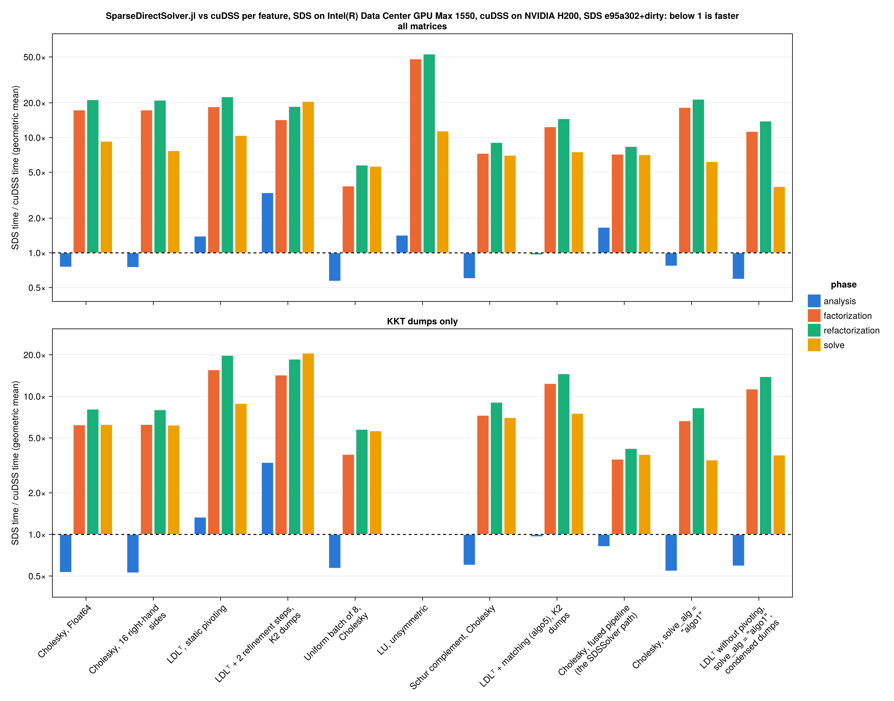

# cuDSS vs SparseDirectSolver.jl

Generated by `bench/compare_report.jl` from `bench/comparison/{cudss,sds_aurora}.csv` (`bench/compare.jl`). Times are BenchmarkTools medians per phase on a fresh solver; the ratio is SDS time / cuDSS time, so below 1 means SparseDirectSolver.jl is faster.

## Overview

Geometric mean of the SDS/cuDSS ratio over the matrices both solvers ran.

| feature | task | status | matrices | analysis | factorization | refactorization | solve |
| --- | --- | --- | --- | --- | --- | --- | --- |
| Cholesky, Float64 | T13 | done | 15 | 0.75× | 17.33× | 21.28× | 9.28× |
| Cholesky, 16 right-hand sides | T12 | done | 15 | 0.75× | 17.32× | 21.07× | 7.69× |
| LDLᵀ, static pivoting | T15 | done | 24 | 1.40× | 18.48× | 22.55× | 10.41× |
| LDLᵀ + 2 refinement steps, K2 dumps | T16 | done | 9 | 3.32× | 14.26× | 18.59× | 20.56× |
| Uniform batch of 8, Cholesky | T17 | done | 10 | 0.57× | 3.80× | 5.77× | 5.63× |
| LU, unsymmetric | T19 | done | 2 | 1.42× | 48.04× | 52.93× | 11.40× |
| Schur complement, Cholesky | T20 | done | 10 | 0.60× | 7.29× | 9.06× | 7.02× |
| LDLᵀ + matching (algo5), K2 dumps | T21 | done | 9 | 0.96× | 12.39× | 14.57× | 7.52× |
| Cholesky, fused pipeline (the `SDSSolver` path) | #126 | done | 15 | 1.66× | 7.17× | 8.37× | 7.10× |
| Cholesky, `solve_alg = "algo1"` | T36 | done | 15 | 0.77× | 18.24× | 21.48× | 6.19× |
| LDLᵀ without pivoting, `solve_alg = "algo1"`, condensed dumps | T36 | done | 10 | 0.59× | 11.29× | 13.89× | 3.76× |

## Overview, KKT dumps only

The same over the MadNLP KKT dumps (matrices `kkt_*`) only, the interior-point workload; features without KKT dumps stay blank.

| feature | task | status | matrices | analysis | factorization | refactorization | solve |
| --- | --- | --- | --- | --- | --- | --- | --- |
| Cholesky, Float64 | T13 | done | 10 | 0.53× | 6.21× | 8.08× | 6.26× |
| Cholesky, 16 right-hand sides | T12 | done | 10 | 0.53× | 6.26× | 7.99× | 6.19× |
| LDLᵀ, static pivoting | T15 | done | 19 | 1.33× | 15.56× | 19.81× | 8.88× |
| LDLᵀ + 2 refinement steps, K2 dumps | T16 | done | 9 | 3.32× | 14.26× | 18.59× | 20.56× |
| Uniform batch of 8, Cholesky | T17 | done | 10 | 0.57× | 3.80× | 5.77× | 5.63× |
| LU, unsymmetric | T19 | done |  |  |  |  |  |
| Schur complement, Cholesky | T20 | done | 10 | 0.60× | 7.29× | 9.06× | 7.02× |
| LDLᵀ + matching (algo5), K2 dumps | T21 | done | 9 | 0.96× | 12.39× | 14.57× | 7.52× |
| Cholesky, fused pipeline (the `SDSSolver` path) | #126 | done | 10 | 0.82× | 3.51× | 4.19× | 3.79× |
| Cholesky, `solve_alg = "algo1"` | T36 | done | 10 | 0.54× | 6.65× | 8.25× | 3.46× |
| LDLᵀ without pivoting, `solve_alg = "algo1"`, condensed dumps | T36 | done | 10 | 0.59× | 11.29× | 13.89× | 3.76× |

## Cholesky, Float64

`cholesky_f64`, T13 (done), structure `SPD`, Float64, nrhs = 1; cuDSS: `matching_alg = "none"`.

| matrix | n | analysis cuDSS ms | SDS ms | ratio | factorization cuDSS ms | SDS ms | ratio | refactorization cuDSS ms | SDS ms | ratio | solve cuDSS ms | SDS ms | ratio | nnz(L) cuDSS | SDS | relres cuDSS | SDS |
| --- | --- | --- | --- | --- | --- | --- | --- | --- | --- | --- | --- | --- | --- | --- | --- | --- | --- |
| Boeing/bcsstk38 | 8032 | 38.8 | 56.4 | 1.45× | 1.93 | 98.4 | 50.94× | 1.72 | 98.4 | 57.33× | 0.57 | 5.36 | 9.40× | 7.99e+05 | 8.05e+05 | 1.08e-10 | 1.04e-10 |
| GHS_psdef/apache2 | 715176 | 4.56e+03 | 7.43e+03 | 1.63× | 76.8 | 3.87e+04 | 504.25× | 76.5 | 3.87e+04 | 506.30× | 3.38 | 243 | 71.88× | 1.45e+08 | 1.29e+08 | 1.79e-10 | 1.77e-10 |
| HB/bcsstk17 | 10974 | 46.5 | 70.9 | 1.53× | 1.96 | 108 | 55.16× | 1.76 | 108 | 61.32× | 0.586 | 6.98 | 11.91× | 1.08e+06 | 1.12e+06 | 3.93e-11 | 6.25e-11 |
| kkt_pglib_opf_case118_ieee_condensed_1 | 1088 | 14.5 | 7.4 | 0.51× | 0.988 | 2.64 | 2.67× | 0.594 | 2.6 | 4.37× | 0.174 | 1.17 | 6.74× | 1.52e+04 | 1.33e+04 | 8.34e-05 | 5.57e-05 |
| kkt_pglib_opf_case118_ieee_condensed_10 | 1088 | 14.5 | 7.34 | 0.51× | 0.77 | 2.64 | 3.42× | 0.566 | 2.59 | 4.58× | 0.161 | 1.17 | 7.30× | 1.52e+04 | 1.33e+04 | 1.28e-05 | 9.12e-06 |
| kkt_pglib_opf_case118_ieee_condensed_20 | 1088 | 14.5 | 7.26 | 0.50× | 0.77 | 2.63 | 3.42× | 0.54 | 2.6 | 4.82× | 0.155 | 1.17 | 7.57× | 1.52e+04 | 1.33e+04 | 0.143 | 0.209 |
| kkt_pglib_opf_case1354_pegase_condensed_1 | 11192 | 62.1 | 67.3 | 1.08× | 0.81 | 10.4 | 12.78× | 0.629 | 10.1 | 16.12× | 0.546 | 2.68 | 4.91× | 1.55e+05 | 1.41e+05 | 0.000598 | 0.000492 |
| kkt_pglib_opf_case1354_pegase_condensed_10 | 11192 | 62.1 | 67.3 | 1.08× | 0.766 | 10.4 | 13.56× | 0.636 | 10.1 | 15.93× | 0.567 | 2.66 | 4.70× | 1.55e+05 | 1.41e+05 | 0.000129 | 0.000104 |
| kkt_pglib_opf_case1354_pegase_condensed_20 | 11192 | 62.1 | 67.1 | 1.08× | 0.764 | 10.2 | 13.32× | 0.631 | 10.1 | 16.04× | 0.568 | 2.66 | 4.69× | 1.55e+05 | 1.41e+05 | 7.65e-05 | 5.44e-05 |
| kkt_pglib_opf_case14_ieee_condensed_1 | 118 | 8.86 | 1.72 | 0.19× | 0.173 | 0.501 | 2.90× | 0.12 | 0.476 | 3.98× | 0.0814 | 0.407 | 5.00× | 1.27e+03 | 1.12e+03 | 3.3e-06 | 9.24e-07 |
| kkt_pglib_opf_case14_ieee_condensed_10 | 118 | 8.87 | 1.71 | 0.19× | 0.164 | 0.505 | 3.08× | 0.121 | 0.479 | 3.97× | 0.0817 | 0.409 | 5.00× | 1.27e+03 | 1.12e+03 | 0.000293 | 0.000236 |
| kkt_pglib_opf_case14_ieee_condensed_16 | 118 | 8.88 | 1.72 | 0.19× | 0.164 | 0.504 | 3.08× | 0.112 | 0.473 | 4.22× | 0.0803 | 0.412 | 5.13× | 1.27e+03 | 1.12e+03 | 7.49e-05 | 6.33e-05 |
| kkt_pglib_opf_case78484_epigrids_condensed_10 | 674562 | 3.81e+03 | 5.72e+03 | 1.50× | 10.8 | 464 | 42.84× | 10.4 | 463 | 44.49× | 1.65 | 29.2 | 17.71× | 1.56e+07 | 1.48e+07 | 0.0179 | 0.0156 |
| lap2d_300 | 90000 | 298 | 449 | 1.51× | 3.31 | 172 | 51.79× | 2.73 | 171 | 62.74× | 0.763 | 10.5 | 13.74× | 2.43e+06 | 2.47e+06 | 1.78e-12 | 1.88e-12 |
| lap3d_40 | 64000 | 375 | 552 | 1.47× | 13.6 | 8.28e+03 | 609.36× | 13.2 | 8.28e+03 | 628.69× | 1.38 | 44.2 | 31.98× | 1.75e+07 | 1.44e+07 | 8.19e-14 | 9.7e-14 |

Single run instead of a BenchmarkTools trial (factorization above the `--single-run-above` limit): SDS on GHS_psdef/apache2, SDS on lap3d_40.

## Cholesky, 16 right-hand sides

`cholesky_nrhs16`, T12 (done), structure `SPD`, Float64, nrhs = 16; cuDSS: `matching_alg = "none"`.

| matrix | n | analysis cuDSS ms | SDS ms | ratio | factorization cuDSS ms | SDS ms | ratio | refactorization cuDSS ms | SDS ms | ratio | solve cuDSS ms | SDS ms | ratio | nnz(L) cuDSS | SDS | relres cuDSS | SDS |
| --- | --- | --- | --- | --- | --- | --- | --- | --- | --- | --- | --- | --- | --- | --- | --- | --- | --- |
| Boeing/bcsstk38 | 8032 | 38.8 | 56.4 | 1.45× | 1.93 | 98.3 | 50.82× | 1.75 | 98.3 | 56.21× | 0.764 | 5.77 | 7.56× | 7.99e+05 | 8.05e+05 | 1.32e-10 | 2.07e-10 |
| GHS_psdef/apache2 | 715176 | 4.56e+03 | 7.18e+03 | 1.58× | 76.9 | 3.87e+04 | 503.68× | 76.6 | 3.87e+04 | 505.87× | 13.7 | 275 | 20.04× | 1.45e+08 | 1.29e+08 | 1.83e-10 | 1.8e-10 |
| HB/bcsstk17 | 10974 | 46.6 | 70.8 | 1.52× | 1.98 | 108 | 54.49× | 1.77 | 108 | 61.04× | 0.821 | 7.49 | 9.12× | 1.08e+06 | 1.12e+06 | 4.52e-11 | 7.23e-11 |
| kkt_pglib_opf_case118_ieee_condensed_1 | 1088 | 14.5 | 7.26 | 0.50× | 0.919 | 2.62 | 2.85× | 0.588 | 2.58 | 4.39× | 0.201 | 1.26 | 6.23× | 1.52e+04 | 1.33e+04 | 0.000111 | 7.46e-05 |
| kkt_pglib_opf_case118_ieee_condensed_10 | 1088 | 14.5 | 7.18 | 0.50× | 0.768 | 2.62 | 3.42× | 0.567 | 2.58 | 4.56× | 0.196 | 1.25 | 6.36× | 1.52e+04 | 1.33e+04 | 1.7e-05 | 1.53e-05 |
| kkt_pglib_opf_case118_ieee_condensed_20 | 1088 | 14.5 | 7.18 | 0.49× | 0.782 | 2.62 | 3.35× | 0.533 | 2.58 | 4.84× | 0.202 | 1.25 | 6.18× | 1.52e+04 | 1.33e+04 | 0.387 | 0.264 |
| kkt_pglib_opf_case1354_pegase_condensed_1 | 11192 | 62.2 | 67 | 1.08× | 0.834 | 10.2 | 12.18× | 0.63 | 10.1 | 15.96× | 0.589 | 3.52 | 5.98× | 1.55e+05 | 1.41e+05 | 0.000706 | 0.000607 |
| kkt_pglib_opf_case1354_pegase_condensed_10 | 11192 | 62.1 | 67 | 1.08× | 0.782 | 10.3 | 13.16× | 0.624 | 10.1 | 16.15× | 0.577 | 3.53 | 6.12× | 1.55e+05 | 1.41e+05 | 0.000148 | 0.000115 |
| kkt_pglib_opf_case1354_pegase_condensed_20 | 11192 | 62.2 | 66.6 | 1.07× | 0.783 | 10.3 | 13.19× | 0.633 | 10.1 | 15.94× | 0.465 | 3.52 | 7.58× | 1.55e+05 | 1.41e+05 | 9.37e-05 | 7.57e-05 |
| kkt_pglib_opf_case14_ieee_condensed_1 | 118 | 8.88 | 1.73 | 0.20× | 0.165 | 0.497 | 3.01× | 0.128 | 0.472 | 3.69× | 0.0965 | 0.422 | 4.37× | 1.27e+03 | 1.12e+03 | 2.72e-06 | 2.43e-06 |
| kkt_pglib_opf_case14_ieee_condensed_10 | 118 | 8.86 | 1.72 | 0.19× | 0.158 | 0.498 | 3.14× | 0.114 | 0.473 | 4.14× | 0.0883 | 0.425 | 4.81× | 1.27e+03 | 1.12e+03 | 0.00135 | 0.000821 |
| kkt_pglib_opf_case14_ieee_condensed_16 | 118 | 8.89 | 1.71 | 0.19× | 0.151 | 0.496 | 3.28× | 0.12 | 0.471 | 3.93× | 0.0906 | 0.422 | 4.66× | 1.27e+03 | 1.12e+03 | 6.91e-05 | 0.000117 |
| kkt_pglib_opf_case78484_epigrids_condensed_10 | 674562 | 3.81e+03 | 5.69e+03 | 1.49× | 10.8 | 464 | 42.90× | 10.5 | 464 | 44.36× | 5.29 | 65.3 | 12.34× | 1.56e+07 | 1.48e+07 | 0.018 | 0.0157 |
| lap2d_300 | 90000 | 298 | 448 | 1.50× | 3.48 | 172 | 49.25× | 2.77 | 171 | 61.98× | 1.46 | 16.4 | 11.25× | 2.43e+06 | 2.47e+06 | 1.8e-12 | 1.89e-12 |
| lap3d_40 | 64000 | 374 | 559 | 1.49× | 13.7 | 8.27e+03 | 602.24× | 13.2 | 8.27e+03 | 627.88× | 3.09 | 46.8 | 15.15× | 1.75e+07 | 1.44e+07 | 8.91e-14 | 1.02e-13 |

Single run instead of a BenchmarkTools trial (factorization above the `--single-run-above` limit): SDS on GHS_psdef/apache2, SDS on lap3d_40.

## LDLᵀ, static pivoting

`ldlt`, T15 (done), structure `S`, Float64, nrhs = 1; cuDSS: `matching_alg = "none"`.

| matrix | n | analysis cuDSS ms | SDS ms | ratio | factorization cuDSS ms | SDS ms | ratio | refactorization cuDSS ms | SDS ms | ratio | solve cuDSS ms | SDS ms | ratio | nnz(L) cuDSS | SDS | relres cuDSS | SDS |
| --- | --- | --- | --- | --- | --- | --- | --- | --- | --- | --- | --- | --- | --- | --- | --- | --- | --- |
| Boeing/bcsstk38 | 8032 | 38.8 | 69 | 1.78× | 2.94 | 123 | 41.99× | 2.77 | 123 | 44.55× | 0.744 | 5.69 | 7.64× | 7.99e+05 | 8.05e+05 | 7.88e-11 | 1.5e-10 |
| GHS_psdef/apache2 | 715176 | 4.55e+03 | 7.46e+03 | 1.64× | 121 | 3.34e+03 | 27.65× | 120 | 3.34e+03 | 27.76× | 3.53 | 264 | 74.88× | 1.45e+08 | 1.29e+08 | 1.57e-10 | 1.47e-10 |
| HB/bcsstk17 | 10974 | 46.5 | 82.1 | 1.76× | 3 | 127 | 42.30× | 2.8 | 126 | 45.11× | 0.766 | 7.31 | 9.54× | 1.08e+06 | 1.12e+06 | 3.59e-11 | 4.54e-11 |
| kkt_pglib_opf_case118_ieee_condensed_1 | 1088 | 14.5 | 8.23 | 0.57× | 0.802 | 8.11 | 10.11× | 0.586 | 8.04 | 13.72× | 0.182 | 1.27 | 6.96× | 1.52e+04 | 1.33e+04 | 6.79e-05 | 9.66e-05 |
| kkt_pglib_opf_case118_ieee_condensed_10 | 1088 | 14.5 | 8.25 | 0.57× | 0.746 | 7.9 | 10.58× | 0.543 | 7.83 | 14.43× | 0.181 | 1.27 | 7.03× | 1.52e+04 | 1.33e+04 | 1.37e-05 | 6.57e-06 |
| kkt_pglib_opf_case118_ieee_condensed_20 | 1088 | 14.5 | 8.19 | 0.56× | 0.742 | 8.04 | 10.84× | 0.532 | 7.97 | 14.98× | 0.183 | 1.28 | 6.97× | 1.52e+04 | 1.33e+04 | 0.179 | 0.0976 |
| kkt_pglib_opf_case118_ieee_k2_1 | 3150 | 19.4 | 85.6 | 4.42× | 0.763 | 7.17 | 9.40× | 0.558 | 7.08 | 12.69× | 0.18 | 1.97 | 10.97× | 2.02e+04 | 2.1e+04 | 1.2 | 0.165 |
| kkt_pglib_opf_case118_ieee_k2_10 | 3150 | 19.4 | 85.6 | 4.42× | 0.942 | 7.04 | 7.48× | 0.577 | 6.97 | 12.07× | 0.185 | 1.99 | 10.76× | 2.02e+04 | 2.05e+04 | 8.16 | 0.0155 |
| kkt_pglib_opf_case118_ieee_k2_20 | 3150 | 19.6 | 84.2 | 4.30× | 0.722 | 7 | 9.70× | 0.588 | 6.91 | 11.75× | 0.195 | 1.96 | 10.08× | 2.02e+04 | 2.05e+04 | 14.8 | 0.0378 |
| kkt_pglib_opf_case1354_pegase_condensed_1 | 11192 | 62.1 | 74.4 | 1.20× | 0.939 | 34.9 | 37.19× | 0.777 | 34.7 | 44.71× | 0.255 | 2.89 | 11.32× | 1.55e+05 | 1.41e+05 | 0.000832 | 0.000462 |
| kkt_pglib_opf_case1354_pegase_condensed_10 | 11192 | 62.1 | 74.5 | 1.20× | 0.929 | 35.2 | 37.91× | 0.76 | 35.1 | 46.22× | 0.275 | 2.88 | 10.50× | 1.55e+05 | 1.41e+05 | 0.00016 | 9.87e-05 |
| kkt_pglib_opf_case1354_pegase_condensed_20 | 11192 | 62.1 | 74.5 | 1.20× | 0.946 | 35.5 | 37.48× | 0.757 | 35.4 | 46.82× | 0.258 | 2.89 | 11.20× | 1.55e+05 | 1.41e+05 | 7.44e-05 | 4.63e-05 |
| kkt_pglib_opf_case1354_pegase_k2_1 | 33811 | 113 | 1.4e+03 | 12.43× | 1.2 | 27.4 | 22.85× | 0.997 | 27.4 | 27.49× | 0.3 | 4.43 | 14.77× | 2.02e+05 | 2.16e+05 | 101 | 15.7 |
| kkt_pglib_opf_case1354_pegase_k2_10 | 33811 | 113 | 1.47e+03 | 13.07× | 1.2 | 25 | 20.77× | 0.937 | 24.9 | 26.59× | 0.314 | 3.67 | 11.68× | 2.02e+05 | 2.2e+05 | 51.7 | 396 |
| kkt_pglib_opf_case1354_pegase_k2_20 | 33811 | 113 | 1.48e+03 | 13.09× | 1.18 | 26.4 | 22.34× | 0.977 | 26.2 | 26.84× | 0.316 | 4.23 | 13.39× | 2.02e+05 | 2.21e+05 | 80.4 | 19.6 |
| kkt_pglib_opf_case14_ieee_condensed_1 | 118 | 8.89 | 1.91 | 0.21× | 0.173 | 1.19 | 6.90× | 0.133 | 1.15 | 8.68× | 0.108 | 0.453 | 4.20× | 1.27e+03 | 1.12e+03 | 1.09e-06 | 1.97e-06 |
| kkt_pglib_opf_case14_ieee_condensed_10 | 118 | 8.89 | 1.91 | 0.21× | 0.177 | 1.19 | 6.74× | 0.125 | 1.16 | 9.33× | 0.107 | 0.449 | 4.21× | 1.27e+03 | 1.12e+03 | 0.000278 | 0.0007 |
| kkt_pglib_opf_case14_ieee_condensed_16 | 118 | 8.87 | 1.91 | 0.22× | 0.17 | 1.29 | 7.55× | 0.132 | 1.25 | 9.48× | 0.107 | 0.455 | 4.24× | 1.27e+03 | 1.12e+03 | 7.61e-05 | 5.22e-05 |
| kkt_pglib_opf_case14_ieee_k2_1 | 344 | 9.65 | 6.87 | 0.71× | 0.193 | 2.47 | 12.78× | 0.15 | 2.42 | 16.08× | 0.119 | 0.991 | 8.35× | 2.02e+03 | 2.14e+03 | 0.189 | 9.88e-09 |
| kkt_pglib_opf_case14_ieee_k2_10 | 344 | 9.65 | 7.92 | 0.82× | 0.185 | 2.47 | 13.31× | 0.149 | 2.43 | 16.30× | 0.123 | 0.99 | 8.03× | 2.02e+03 | 2.15e+03 | 0.341 | 1.65e-05 |
| kkt_pglib_opf_case14_ieee_k2_15 | 344 | 9.7 | 4.34 | 0.45× | 0.188 | 3.87 | 20.62× | 0.149 | 3.81 | 25.57× | 0.12 | 1.07 | 8.88× | 2.02e+03 | 3.27e+03 | 0.276 | 0.115 |
| kkt_pglib_opf_case78484_epigrids_condensed_10 | 674562 | 3.82e+03 | 6.2e+03 | 1.62× | 16.2 | 1.33e+03 | 82.14× | 15.8 | 1.33e+03 | 84.25× | 1.73 | 32.4 | 18.76× | 1.56e+07 | 1.48e+07 | 0.0174 | 0.0124 |
| lap2d_300 | 90000 | 283 | 476 | 1.68× | 4.43 | 130 | 29.45× | 4.16 | 130 | 31.28× | 0.879 | 12.3 | 13.97× | 2.43e+06 | 2.47e+06 | 1.59e-12 | 1.6e-12 |
| lap3d_40 | 64000 | 363 | 534 | 1.47× | 22.5 | 873 | 38.81× | 22.4 | 873 | 39.00× | 1.48 | 49.2 | 33.19× | 1.75e+07 | 1.44e+07 | 7.5e-14 | 6.18e-14 |

## LDLᵀ + 2 refinement steps, K2 dumps

`ldlt_ir2`, T16 (done), structure `S`, Float64, nrhs = 1; both solvers: `ir_n_steps = 2`; cuDSS: `matching_alg = "none"`.

| matrix | n | analysis cuDSS ms | SDS ms | ratio | factorization cuDSS ms | SDS ms | ratio | refactorization cuDSS ms | SDS ms | ratio | solve cuDSS ms | SDS ms | ratio | nnz(L) cuDSS | SDS | relres cuDSS | SDS |
| --- | --- | --- | --- | --- | --- | --- | --- | --- | --- | --- | --- | --- | --- | --- | --- | --- | --- |
| kkt_pglib_opf_case118_ieee_k2_1 | 3150 | 19.4 | 85.7 | 4.41× | 0.952 | 6.96 | 7.31× | 0.584 | 7.22 | 12.37× | 0.464 | 8.18 | 17.62× | 2.02e+04 | 2.1e+04 | 0.00223 | 1.58e-09 |
| kkt_pglib_opf_case118_ieee_k2_10 | 3150 | 19.4 | 85.8 | 4.42× | 0.755 | 6.85 | 9.08× | 0.524 | 6.99 | 13.35× | 0.46 | 8.15 | 17.73× | 2.02e+04 | 2.05e+04 | 0.856 | 3.17e-09 |
| kkt_pglib_opf_case118_ieee_k2_20 | 3150 | 19.6 | 84.5 | 4.32× | 0.751 | 6.96 | 9.26× | 0.538 | 6.8 | 12.64× | 0.441 | 8.12 | 18.42× | 2.02e+04 | 2.05e+04 | 0.045 | 1.26e-08 |
| kkt_pglib_opf_case1354_pegase_k2_1 | 33811 | 113 | 1.4e+03 | 12.44× | 1.16 | 27.4 | 23.71× | 0.971 | 27.3 | 28.14× | 0.838 | 36.3 | 43.28× | 2.02e+05 | 2.16e+05 | 36.2 | 0.0417 |
| kkt_pglib_opf_case1354_pegase_k2_10 | 33811 | 113 | 1.48e+03 | 13.15× | 1.16 | 24.8 | 21.41× | 0.994 | 24.8 | 24.93× | 0.834 | 34.3 | 41.14× | 2.02e+05 | 2.2e+05 | 2.02 | 4.66e+03 |
| kkt_pglib_opf_case1354_pegase_k2_20 | 33811 | 113 | 1.49e+03 | 13.23× | 1.2 | 26.2 | 21.80× | 0.977 | 26.2 | 26.88× | 0.834 | 35.5 | 42.55× | 2.02e+05 | 2.21e+05 | 0.967 | 0.0133 |
| kkt_pglib_opf_case14_ieee_k2_1 | 344 | 9.66 | 6.89 | 0.71× | 0.185 | 2.46 | 13.35× | 0.148 | 2.42 | 16.36× | 0.295 | 3.24 | 10.98× | 2.02e+03 | 2.14e+03 | 6.71e-07 | 7.41e-13 |
| kkt_pglib_opf_case14_ieee_k2_10 | 344 | 9.66 | 7.98 | 0.83× | 0.193 | 2.47 | 12.78× | 0.153 | 2.44 | 15.93× | 0.29 | 3.24 | 11.17× | 2.02e+03 | 2.15e+03 | 1.44e-07 | 3.39e-14 |
| kkt_pglib_opf_case14_ieee_k2_15 | 344 | 9.67 | 4.42 | 0.46× | 0.184 | 3.88 | 21.03× | 0.148 | 3.84 | 25.90× | 0.293 | 3.59 | 12.27× | 2.02e+03 | 3.27e+03 | 5.72e-07 | 5.24e-09 |

## Uniform batch of 8, Cholesky

`ubatch8`, T17 (done), structure `SPD`, Float64, nrhs = 1, uniform batch of 8; cuDSS: `matching_alg = "none"`.

| matrix | n | analysis cuDSS ms | SDS ms | ratio | factorization cuDSS ms | SDS ms | ratio | refactorization cuDSS ms | SDS ms | ratio | solve cuDSS ms | SDS ms | ratio | nnz(L) cuDSS | SDS | relres cuDSS | SDS |
| --- | --- | --- | --- | --- | --- | --- | --- | --- | --- | --- | --- | --- | --- | --- | --- | --- | --- |
| kkt_pglib_opf_case118_ieee_condensed_1 | 1088 | 14.5 | 8.1 | 0.56× | 0.776 | 2.71 | 3.49× | 0.577 | 2.66 | 4.61× | 0.181 | 1.23 | 6.77× | 1.52e+04 | 1.33e+04 | 5.43e-05 | 3.82e-05 |
| kkt_pglib_opf_case118_ieee_condensed_10 | 1088 | 14.5 | 8.12 | 0.56× | 0.768 | 2.71 | 3.53× | 0.552 | 2.66 | 4.83× | 0.194 | 1.23 | 6.35× | 1.52e+04 | 1.33e+04 | 9.5e-06 | 8.79e-06 |
| kkt_pglib_opf_case118_ieee_condensed_20 | 1088 | 14.5 | 8.15 | 0.56× | 0.773 | 2.71 | 3.50× | 0.549 | 2.67 | 4.86× | 0.195 | 1.23 | 6.31× | 1.52e+04 | 1.33e+04 | 0.162 | 0.148 |
| kkt_pglib_opf_case1354_pegase_condensed_1 | 11192 | 62.2 | 69.9 | 1.12× | 1.51 | 11 | 7.25× | 1.3 | 10.9 | 8.35× | 0.57 | 3.03 | 5.31× | 1.55e+05 | 1.41e+05 | 0.000641 | 0.000498 |
| kkt_pglib_opf_case1354_pegase_condensed_10 | 11192 | 62.1 | 69.9 | 1.13× | 1.48 | 10.9 | 7.40× | 1.29 | 10.9 | 8.46× | 0.646 | 3.01 | 4.66× | 1.55e+05 | 1.41e+05 | 0.000136 | 0.000102 |
| kkt_pglib_opf_case1354_pegase_condensed_20 | 11192 | 62.2 | 69.9 | 1.12× | 1.52 | 11 | 7.22× | 1.27 | 10.9 | 8.56× | 0.559 | 3.02 | 5.41× | 1.55e+05 | 1.41e+05 | 7.34e-05 | 5.2e-05 |
| kkt_pglib_opf_case14_ieee_condensed_1 | 118 | 8.88 | 1.9 | 0.21× | 0.336 | 0.518 | 1.54× | 0.117 | 0.487 | 4.16× | 0.0982 | 0.414 | 4.21× | 1.27e+03 | 1.12e+03 | 1.87e-06 | 9.49e-07 |
| kkt_pglib_opf_case14_ieee_condensed_10 | 118 | 8.87 | 1.89 | 0.21× | 0.345 | 0.515 | 1.49× | 0.13 | 0.485 | 3.74× | 0.1 | 0.415 | 4.15× | 1.27e+03 | 1.12e+03 | 0.000622 | 0.000211 |
| kkt_pglib_opf_case14_ieee_condensed_16 | 118 | 8.89 | 1.86 | 0.21× | 0.352 | 0.513 | 1.46× | 0.135 | 0.483 | 3.58× | 0.104 | 0.412 | 3.98× | 1.27e+03 | 1.12e+03 | 4.61e-05 | 5.04e-05 |
| kkt_pglib_opf_case78484_epigrids_condensed_10 | 674562 | 3.82e+03 | 5.68e+03 | 1.49× | 58.2 | 644 | 11.07× | 57.7 | 642 | 11.14× | 8.26 | 104 | 12.59× | 1.56e+07 | 1.48e+07 | 0.0178 | 0.0157 |

## LU, unsymmetric

`lu`, T19 (done), structure `G`, Float64, nrhs = 1; cuDSS: `matching_alg = "none"`.

| matrix | n | analysis cuDSS ms | SDS ms | ratio | factorization cuDSS ms | SDS ms | ratio | refactorization cuDSS ms | SDS ms | ratio | solve cuDSS ms | SDS ms | ratio | nnz(L) cuDSS | SDS | relres cuDSS | SDS |
| --- | --- | --- | --- | --- | --- | --- | --- | --- | --- | --- | --- | --- | --- | --- | --- | --- | --- |
| Rajat/rajat21 | 411676 | 1.9e+03 | 3.11e+03 | 1.64× | 16.6 | 1.63e+03 | 98.64× | 16.2 | 1.64e+03 | 101.16× | 1.83 | 69.7 | 38.09× | 6.89e+06 | 2.37e+06 | 3.77e+08 | 6.47e+03 |
| TSOPF/TSOPF_RS_b39_c7 | 14098 | 108 | 133 | 1.24× | 1.21 | 28.4 | 23.39× | 1.02 | 28.3 | 27.70× | 0.553 | 1.88 | 3.41× | 1.47e+06 | 7.27e+05 | 5.33e+30 | 2.69e+30 |

## Schur complement, Cholesky

`schur`, T20 (done), structure `SPD`, Float64, nrhs = 1; both solvers: `schur_mode = 1`; cuDSS: `matching_alg = "none"`.

| matrix | n | analysis cuDSS ms | SDS ms | ratio | factorization cuDSS ms | SDS ms | ratio | refactorization cuDSS ms | SDS ms | ratio | solve cuDSS ms | SDS ms | ratio | nnz(L) cuDSS | SDS | relres cuDSS | SDS |
| --- | --- | --- | --- | --- | --- | --- | --- | --- | --- | --- | --- | --- | --- | --- | --- | --- | --- |
| kkt_pglib_opf_case118_ieee_condensed_1 | 1088 | 14.4 | 7.9 | 0.55× | 0.784 | 3.61 | 4.60× | 0.549 | 3.47 | 6.33× | 0.0901 | 0.696 | 7.72× | 1.96e+04 | 1.83e+04 |  |  |
| kkt_pglib_opf_case118_ieee_condensed_10 | 1088 | 14.4 | 7.91 | 0.55× | 0.8 | 3.71 | 4.63× | 0.55 | 3.62 | 6.57× | 0.0941 | 0.695 | 7.39× | 1.96e+04 | 1.83e+04 |  |  |
| kkt_pglib_opf_case118_ieee_condensed_20 | 1088 | 14.4 | 7.91 | 0.55× | 0.77 | 3.71 | 4.83× | 0.574 | 3.48 | 6.06× | 0.107 | 0.696 | 6.51× | 1.96e+04 | 1.83e+04 |  |  |
| kkt_pglib_opf_case1354_pegase_condensed_1 | 11192 | 63.1 | 77 | 1.22× | 0.862 | 12.1 | 13.98× | 0.732 | 11.8 | 16.15× | 0.138 | 1.24 | 9.01× | 1.65e+05 | 1.53e+05 |  |  |
| kkt_pglib_opf_case1354_pegase_condensed_10 | 11192 | 63.2 | 77.3 | 1.22× | 0.849 | 12.1 | 14.24× | 0.666 | 12 | 18.03× | 0.129 | 1.24 | 9.62× | 1.65e+05 | 1.53e+05 |  |  |
| kkt_pglib_opf_case1354_pegase_condensed_20 | 11192 | 63.1 | 77.1 | 1.22× | 0.846 | 11.9 | 14.10× | 0.655 | 12 | 18.31× | 0.139 | 1.25 | 9.00× | 1.65e+05 | 1.53e+05 |  |  |
| kkt_pglib_opf_case14_ieee_condensed_1 | 118 | 8.88 | 1.96 | 0.22× | 0.191 | 0.665 | 3.47× | 0.161 | 0.613 | 3.81× | 0.0659 | 0.252 | 3.83× | 1.51e+03 | 1.3e+03 |  |  |
| kkt_pglib_opf_case14_ieee_condensed_10 | 118 | 8.86 | 1.94 | 0.22× | 0.208 | 0.661 | 3.18× | 0.147 | 0.618 | 4.20× | 0.0699 | 0.249 | 3.57× | 1.51e+03 | 1.3e+03 |  |  |
| kkt_pglib_opf_case14_ieee_condensed_16 | 118 | 8.89 | 1.95 | 0.22× | 0.206 | 0.665 | 3.23× | 0.151 | 0.616 | 4.08× | 0.0679 | 0.25 | 3.68× | 1.51e+03 | 1.3e+03 |  |  |
| kkt_pglib_opf_case78484_epigrids_condensed_10 | 674562 | 3.86e+03 | 7.28e+03 | 1.89× | 12 | 490 | 40.91× | 11.5 | 489 | 42.42× | 0.875 | 17.3 | 19.82× | 1.57e+07 | 1.5e+07 |  |  |

## LDLᵀ + matching (algo5), K2 dumps

`ldlt_matching`, T21 (done), structure `S`, Float64, nrhs = 1; both solvers: `matching_alg = "algo5"`; cuDSS: `matching_alg = "algo5"`.

| matrix | n | analysis cuDSS ms | SDS ms | ratio | factorization cuDSS ms | SDS ms | ratio | refactorization cuDSS ms | SDS ms | ratio | solve cuDSS ms | SDS ms | ratio | nnz(L) cuDSS | SDS | relres cuDSS | SDS |
| --- | --- | --- | --- | --- | --- | --- | --- | --- | --- | --- | --- | --- | --- | --- | --- | --- | --- |
| kkt_pglib_opf_case118_ieee_k2_1 | 3150 | 17.9 | 18.9 | 1.05× | 0.832 | 11.6 | 13.88× | 0.644 | 11.5 | 17.91× | 0.211 | 1.75 | 8.30× | 4.59e+04 | 4.03e+04 | 3.94e-12 | 5.31e-12 |
| kkt_pglib_opf_case118_ieee_k2_10 | 3150 | 17.9 | 20.4 | 1.14× | 0.793 | 9.58 | 12.08× | 0.615 | 9.51 | 15.48× | 0.202 | 1.82 | 9.02× | 4.47e+04 | 3.88e+04 | 9.29e-13 | 9.87e-13 |
| kkt_pglib_opf_case118_ieee_k2_20 | 3150 | 18.1 | 19.5 | 1.08× | 1.02 | 8.95 | 8.80× | 0.617 | 8.9 | 14.42× | 0.197 | 1.61 | 8.18× | 4.37e+04 | 3.84e+04 | 4.07e-13 | 3.43e-13 |
| kkt_pglib_opf_case1354_pegase_k2_1 | 33811 | 87.1 | 199 | 2.29× | 1.4 | 42.3 | 30.14× | 1.2 | 42.1 | 35.05× | 0.666 | 3.53 | 5.31× | 4.56e+05 | 4.1e+05 | 0.0103 | 2.27e-05 |
| kkt_pglib_opf_case1354_pegase_k2_10 | 33811 | 89.5 | 211 | 2.36× | 1.44 | 44.9 | 31.26× | 1.23 | 44.9 | 36.50× | 0.309 | 3.61 | 11.70× | 4.56e+05 | 4.13e+05 | 5.26e-06 | 0.000178 |
| kkt_pglib_opf_case1354_pegase_k2_20 | 33811 | 92.3 | 228 | 2.47× | 1.46 | 52.2 | 35.86× | 1.24 | 52.1 | 41.89× | 0.646 | 4.1 | 6.36× | 4.51e+05 | 4.17e+05 | 9.65e-05 | 1.92e-05 |
| kkt_pglib_opf_case14_ieee_k2_1 | 344 | 9.57 | 3.38 | 0.35× | 0.601 | 3.54 | 5.90× | 0.548 | 3.46 | 6.31× | 0.129 | 1.05 | 8.17× | 4.5e+03 | 3.65e+03 | 1.79e-12 | 6.76e-13 |
| kkt_pglib_opf_case14_ieee_k2_10 | 344 | 9.44 | 3.26 | 0.35× | 0.591 | 2.87 | 4.86× | 0.604 | 2.82 | 4.67× | 0.131 | 0.905 | 6.89× | 4.53e+03 | 3.52e+03 | 4.33e-14 | 4.58e-14 |
| kkt_pglib_opf_case14_ieee_k2_15 | 344 | 9.46 | 3.24 | 0.34× | 0.616 | 2.96 | 4.81× | 0.621 | 2.9 | 4.67× | 0.151 | 0.853 | 5.63× | 4.53e+03 | 3.68e+03 | 6.18e-14 | 4.52e-14 |

## Cholesky, fused pipeline (the `SDSSolver` path)

`cholesky_fused`, #126 (done), structure `SPD`, Float64, nrhs = 1, SDS through a `FusedSolver` (the fused factorization and partitioned-inverse solve the MadNLP extension runs; its analysis phase includes a stock factorization and building the fused plans), cuDSS through its one path; cuDSS: `matching_alg = "none"`.

| matrix | n | analysis cuDSS ms | SDS ms | ratio | factorization cuDSS ms | SDS ms | ratio | refactorization cuDSS ms | SDS ms | ratio | solve cuDSS ms | SDS ms | ratio | nnz(L) cuDSS | SDS | relres cuDSS | SDS |
| --- | --- | --- | --- | --- | --- | --- | --- | --- | --- | --- | --- | --- | --- | --- | --- | --- | --- |
| Boeing/bcsstk38 | 8032 | 38.9 | 175 | 4.49× | 1.96 | 37.8 | 19.32× | 1.75 | 38.1 | 21.80× | 0.6 | 5.36 | 8.94× | 7.99e+05 | 8.06e+05 | 8.74e-11 | 1.36e-09 |
| GHS_psdef/apache2 | 715176 | 4.56e+03 | 5.92e+04 | 12.98× | 77 | 4.42e+03 | 57.48× | 76.7 | 4.41e+03 | 57.56× | 3.43 | 227 | 66.35× | 1.45e+08 | 1.34e+08 | 1.79e-10 | 1.72e-10 |
| HB/bcsstk17 | 10974 | 46.5 | 224 | 4.82× | 1.99 | 43.3 | 21.79× | 1.8 | 50.4 | 27.98× | 0.611 | 6.91 | 11.30× | 1.08e+06 | 1.1e+06 | 3.22e-11 | 5.17e-11 |
| kkt_pglib_opf_case118_ieee_condensed_1 | 1088 | 14.5 | 12.8 | 0.88× | 0.794 | 1.52 | 1.92× | 0.593 | 1.33 | 2.24× | 0.172 | 0.591 | 3.44× | 1.52e+04 | 1.33e+04 | 9.1e-05 | 0.000374 |
| kkt_pglib_opf_case118_ieee_condensed_10 | 1088 | 14.5 | 12.9 | 0.89× | 0.816 | 1.5 | 1.84× | 0.562 | 1.43 | 2.55× | 0.164 | 0.593 | 3.61× | 1.52e+04 | 1.33e+04 | 1.62e-05 | 8.06e-05 |
| kkt_pglib_opf_case118_ieee_condensed_20 | 1088 | 14.5 | 12.8 | 0.88× | 0.774 | 1.54 | 1.99× | 0.578 | 1.39 | 2.40× | 0.165 | 0.573 | 3.48× | 1.52e+04 | 1.33e+04 | 0.142 | 0.23 |
| kkt_pglib_opf_case1354_pegase_condensed_1 | 11192 | 62.2 | 81.6 | 1.31× | 0.85 | 3.16 | 3.72× | 0.649 | 2.76 | 4.25× | 0.581 | 1.71 | 2.94× | 1.55e+05 | 1.41e+05 | 0.00065 | 0.000513 |
| kkt_pglib_opf_case1354_pegase_condensed_10 | 11192 | 62.1 | 81.7 | 1.31× | 0.786 | 3.02 | 3.84× | 0.61 | 3.21 | 5.27× | 0.571 | 1.69 | 2.96× | 1.55e+05 | 1.41e+05 | 0.000132 | 0.00012 |
| kkt_pglib_opf_case1354_pegase_condensed_20 | 11192 | 62.1 | 81.7 | 1.31× | 0.783 | 3.11 | 3.97× | 0.63 | 2.86 | 4.55× | 0.562 | 1.71 | 3.04× | 1.55e+05 | 1.41e+05 | 7.54e-05 | 6.55e-05 |
| kkt_pglib_opf_case14_ieee_condensed_1 | 118 | 8.89 | 3.24 | 0.36× | 0.161 | 0.565 | 3.52× | 0.126 | 0.512 | 4.08× | 0.0825 | 0.264 | 3.20× | 1.27e+03 | 1.12e+03 | 2.26e-06 | 1.5e-06 |
| kkt_pglib_opf_case14_ieee_condensed_10 | 118 | 8.9 | 3.24 | 0.36× | 0.161 | 0.56 | 3.47× | 0.129 | 0.508 | 3.93× | 0.0854 | 0.262 | 3.07× | 1.27e+03 | 1.12e+03 | 0.000942 | 0.000329 |
| kkt_pglib_opf_case14_ieee_condensed_16 | 118 | 8.9 | 3.22 | 0.36× | 0.165 | 0.552 | 3.34× | 0.121 | 0.497 | 4.12× | 0.0868 | 0.254 | 2.93× | 1.27e+03 | 1.12e+03 | 5.88e-05 | 5.22e-05 |
| kkt_pglib_opf_case78484_epigrids_condensed_10 | 674562 | 3.82e+03 | 6.81e+03 | 1.78× | 10.8 | 187 | 17.26× | 10.4 | 188 | 18.13× | 1.63 | 30.2 | 18.55× | 1.56e+07 | 1.48e+07 | 0.0177 | 0.0276 |
| lap2d_300 | 90000 | 284 | 687 | 2.42× | 3.04 | 83.4 | 27.45× | 2.78 | 86.4 | 31.05× | 0.796 | 10.6 | 13.37× | 2.43e+06 | 2.37e+06 | 1.78e-12 | 1.91e-12 |
| lap3d_40 | 64000 | 376 | 8.65e+03 | 23.00× | 13.8 | 500 | 36.13× | 13.1 | 496 | 37.71× | 1.41 | 151 | 106.80× | 1.75e+07 | 1.44e+07 | 8.22e-14 | 7.52e-14 |

## Cholesky, `solve_alg = "algo1"`

`cholesky_algo1`, T36 (done), structure `SPD`, Float64, nrhs = 1; cuDSS: `matching_alg = "none"`; SDS: `solve_alg = "algo1"`.

| matrix | n | analysis cuDSS ms | SDS ms | ratio | factorization cuDSS ms | SDS ms | ratio | refactorization cuDSS ms | SDS ms | ratio | solve cuDSS ms | SDS ms | ratio | nnz(L) cuDSS | SDS | relres cuDSS | SDS |
| --- | --- | --- | --- | --- | --- | --- | --- | --- | --- | --- | --- | --- | --- | --- | --- | --- | --- |
| Boeing/bcsstk38 | 8032 | 38.9 | 56.2 | 1.44× | 1.94 | 99.2 | 51.08× | 1.78 | 99.1 | 55.58× | 0.589 | 5.51 | 9.36× | 7.99e+05 | 8.05e+05 | 6.8e-11 | 4.05e-09 |
| GHS_psdef/apache2 | 715176 | 4.56e+03 | 7.55e+03 | 1.65× | 77 | 3.87e+04 | 502.51× | 76.5 | 3.87e+04 | 506.10× | 3.42 | 250 | 73.01× | 1.45e+08 | 1.29e+08 | 1.8e-10 | 1.89e-10 |
| HB/bcsstk17 | 10974 | 46.5 | 70.6 | 1.52× | 1.98 | 109 | 54.92× | 1.82 | 108 | 59.67× | 0.62 | 6.37 | 10.28× | 1.08e+06 | 1.12e+06 | 3.61e-11 | 5.48e-11 |
| kkt_pglib_opf_case118_ieee_condensed_1 | 1088 | 14.5 | 7.56 | 0.52× | 0.805 | 2.7 | 3.36× | 0.562 | 2.65 | 4.72× | 0.169 | 0.469 | 2.77× | 1.52e+04 | 1.33e+04 | 7.33e-05 | 0.000321 |
| kkt_pglib_opf_case118_ieee_condensed_10 | 1088 | 14.5 | 7.53 | 0.52× | 0.789 | 2.7 | 3.43× | 0.59 | 2.65 | 4.49× | 0.154 | 0.457 | 2.96× | 1.52e+04 | 1.33e+04 | 1.17e-05 | 1.88e-05 |
| kkt_pglib_opf_case118_ieee_condensed_20 | 1088 | 14.5 | 7.49 | 0.52× | 0.771 | 2.71 | 3.51× | 0.609 | 2.65 | 4.35× | 0.174 | 0.462 | 2.66× | 1.52e+04 | 1.33e+04 | 0.152 | 0.227 |
| kkt_pglib_opf_case1354_pegase_condensed_1 | 11192 | 62.1 | 67.8 | 1.09× | 0.841 | 10.3 | 12.30× | 0.627 | 10.3 | 16.40× | 0.574 | 1.77 | 3.08× | 1.55e+05 | 1.41e+05 | 0.000638 | 0.000567 |
| kkt_pglib_opf_case1354_pegase_condensed_10 | 11192 | 62.1 | 67.5 | 1.09× | 0.774 | 10.5 | 13.62× | 0.636 | 10.5 | 16.48× | 0.572 | 1.78 | 3.12× | 1.55e+05 | 1.41e+05 | 0.00014 | 0.000229 |
| kkt_pglib_opf_case1354_pegase_condensed_20 | 11192 | 62.2 | 67.5 | 1.09× | 0.79 | 10.5 | 13.33× | 0.649 | 10.5 | 16.11× | 0.553 | 1.76 | 3.19× | 1.55e+05 | 1.41e+05 | 7.02e-05 | 6.85e-05 |
| kkt_pglib_opf_case14_ieee_condensed_1 | 118 | 8.87 | 1.8 | 0.20× | 0.161 | 0.561 | 3.48× | 0.122 | 0.529 | 4.34× | 0.0853 | 0.239 | 2.80× | 1.27e+03 | 1.12e+03 | 2.39e-06 | 1.01e-06 |
| kkt_pglib_opf_case14_ieee_condensed_10 | 118 | 8.87 | 1.79 | 0.20× | 0.16 | 0.565 | 3.54× | 0.122 | 0.528 | 4.32× | 0.0843 | 0.231 | 2.74× | 1.27e+03 | 1.12e+03 | 0.000736 | 0.000355 |
| kkt_pglib_opf_case14_ieee_condensed_16 | 118 | 8.91 | 1.78 | 0.20× | 0.159 | 0.559 | 3.51× | 0.124 | 0.529 | 4.27× | 0.0837 | 0.238 | 2.85× | 1.27e+03 | 1.12e+03 | 4.46e-05 | 5.34e-05 |
| kkt_pglib_opf_case78484_epigrids_condensed_10 | 674562 | 3.83e+03 | 5.86e+03 | 1.53× | 10.9 | 474 | 43.44× | 10.4 | 473 | 45.62× | 1.63 | 27.7 | 17.02× | 1.56e+07 | 1.48e+07 | 0.0177 | 0.0239 |
| lap2d_300 | 90000 | 284 | 449 | 1.58× | 3.09 | 173 | 55.91× | 2.78 | 172 | 62.10× | 0.79 | 12 | 15.13× | 2.43e+06 | 2.47e+06 | 1.78e-12 | 1.99e-12 |
| lap3d_40 | 64000 | 363 | 550 | 1.52× | 13.4 | 8.27e+03 | 616.53× | 13.2 | 8.27e+03 | 625.09× | 1.42 | 40.1 | 28.21× | 1.75e+07 | 1.44e+07 | 8.21e-14 | 9.86e-14 |

Single run instead of a BenchmarkTools trial (factorization above the `--single-run-above` limit): SDS on GHS_psdef/apache2, SDS on lap3d_40.

## LDLᵀ without pivoting, `solve_alg = "algo1"`, condensed dumps

`ldlt_algo1`, T36 (done), structure `S`, Float64, nrhs = 1; both solvers: `pivot_type = 'N'`; cuDSS: `matching_alg = "none"`; SDS: `solve_alg = "algo1"`.

| matrix | n | analysis cuDSS ms | SDS ms | ratio | factorization cuDSS ms | SDS ms | ratio | refactorization cuDSS ms | SDS ms | ratio | solve cuDSS ms | SDS ms | ratio | nnz(L) cuDSS | SDS | relres cuDSS | SDS |
| --- | --- | --- | --- | --- | --- | --- | --- | --- | --- | --- | --- | --- | --- | --- | --- | --- | --- |
| kkt_pglib_opf_case118_ieee_condensed_1 | 1088 | 14.5 | 8.36 | 0.58× | 0.779 | 4.75 | 6.09× | 0.597 | 4.83 | 8.09× | 0.157 | 0.564 | 3.60× | 1.52e+04 | 1.33e+04 | 5.99e-05 | 0.000392 |
| kkt_pglib_opf_case118_ieee_condensed_10 | 1088 | 14.5 | 8.31 | 0.57× | 0.78 | 4.9 | 6.28× | 0.593 | 4.83 | 8.14× | 0.176 | 0.563 | 3.20× | 1.52e+04 | 1.33e+04 | 1.47e-05 | 1.49e-05 |
| kkt_pglib_opf_case118_ieee_condensed_20 | 1088 | 14.5 | 8.19 | 0.57× | 0.772 | 4.91 | 6.36× | 0.592 | 4.61 | 7.79× | 0.156 | 0.562 | 3.61× | 1.52e+04 | 1.33e+04 | 0.143 | 0.339 |
| kkt_pglib_opf_case1354_pegase_condensed_1 | 11192 | 62.1 | 73.1 | 1.18× | 0.681 | 20.1 | 29.57× | 0.621 | 20 | 32.22× | 0.573 | 1.71 | 2.99× | 1.55e+05 | 1.41e+05 | 0.000589 | 0.000534 |
| kkt_pglib_opf_case1354_pegase_condensed_10 | 11192 | 62.2 | 72.4 | 1.17× | 0.769 | 20.1 | 26.11× | 0.629 | 20 | 31.77× | 0.541 | 1.73 | 3.19× | 1.55e+05 | 1.41e+05 | 0.000137 | 0.000134 |
| kkt_pglib_opf_case1354_pegase_condensed_20 | 11192 | 62.2 | 72.2 | 1.16× | 0.805 | 20.1 | 24.95× | 0.625 | 20 | 32.00× | 0.567 | 1.73 | 3.05× | 1.55e+05 | 1.41e+05 | 7.53e-05 | 7.31e-05 |
| kkt_pglib_opf_case14_ieee_condensed_1 | 118 | 8.91 | 1.98 | 0.22× | 0.165 | 0.889 | 5.38× | 0.12 | 0.855 | 7.13× | 0.0874 | 0.26 | 2.98× | 1.27e+03 | 1.12e+03 | 1.06e-06 | 2.66e-06 |
| kkt_pglib_opf_case14_ieee_condensed_10 | 118 | 8.88 | 1.96 | 0.22× | 0.155 | 0.885 | 5.71× | 0.116 | 0.848 | 7.32× | 0.088 | 0.267 | 3.04× | 1.27e+03 | 1.12e+03 | 0.000691 | 0.000328 |
| kkt_pglib_opf_case14_ieee_condensed_16 | 118 | 8.89 | 1.94 | 0.22× | 0.155 | 0.892 | 5.77× | 0.12 | 0.863 | 7.16× | 0.086 | 0.265 | 3.08× | 1.27e+03 | 1.12e+03 | 3.97e-05 | 3.84e-05 |
| kkt_pglib_opf_case78484_epigrids_condensed_10 | 674562 | 3.83e+03 | 6.32e+03 | 1.65× | 11 | 446 | 40.51× | 10.6 | 450 | 42.52× | 1.63 | 27.2 | 16.66× | 1.56e+07 | 1.48e+07 | 0.0172 | 0.0242 |

## Runs

* cuDSS 1.0.0 on NVIDIA H200, repository 352271c, 2026-11-09.
* SparseDirectSolver.jl 0.3.0 on Intel(R) Data Center GPU Max 1550, repository e95a302+dirty, 2026-11-10.
